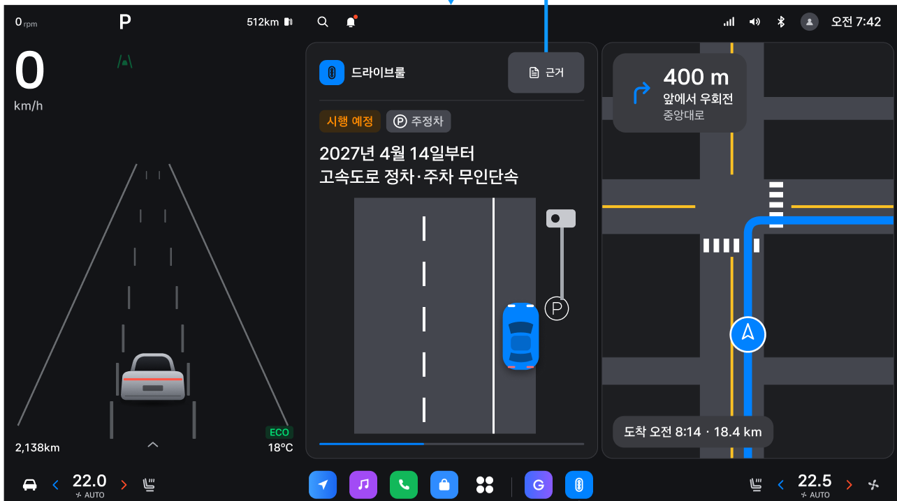

# DRIVE RULE Android 개발 컨벤션

작성일: 2026-11-12 · 적용 위치: `android/` · 상태: 개발 시작 기준 v1.1 (프로젝트 구조 구체화)

이 문서는 사용자 최신 요청과 저장소의 채택된 결정을 연결한다. **확정 요구**, **이번에 정한 개발 기준**, **검증 대기**를 구분한다. 근거와 접근 결과는 [출처 및 검증 기록](../docs/android/source-check-2026-11-12.md)에 있다.

## 1. 제품 목표와 구현 범위

DRIVE RULE은 검수한 교통 법령 정보를 운전 상황에 맞춰 미리 알려 주는 Pleos Connect 차량용 앱이다. 법 위반을 단속하거나 조향·제동을 제어하는 앱이 아니다.

| 단계 | 사용자 경험 | 이번 범위 |
|---|---|---|
| 최초 설정 | 이름을 등록한다. 건너뛰면 ‘운전자 1’을 만든다. | 포함 |
| 출발 전 | 운전자별 미확인·변경 법령을 확인하고, 가능한 경우 목적지 주변 정보를 함께 받는다. | 포함 |
| 주행 중 | 지원되는 상황 신호로 다가오는 이벤트를 판단해 짧은 음성과 카드를 제공한다. 카드는 자동으로 닫힌다. | 포함, 플랫폼 검증 필요 |
| Gleo 질의응답 | Gleo가 질문을 정리하고 검수된 법령 정보를 조회해 전달한다. | 후속 기능 2 |

사용자 예시는 과속, 어린이보호구역, 우회전·좌회전, 안전거리다. 모두 감지 가능하다는 뜻은 아니다. 첫 개발은 **가짜 신호로 이벤트 → 검수 카드 선택 → 음성/카드 → 자동 종료**의 전체 흐름을 만든 뒤 검증된 SDK adapter를 연결한다.

첨부의 스쿨존·주정차·우회전 3개 분류와 Figma의 A·B·H·I는 기존 기획을 설명하는 후보 자료다. Figma에서 제시한 거리도 장치 검증 전 제품 고정값으로 사용하지 않는다. 안전거리 이벤트는 선행 차량 거리 등 필요한 입력을 확인하기 전 지원 목록에 넣지 않는다.

**디자인과 최신 요청의 차이:** 확인한 Figma v6.0은 주행 중 음성만 제공하고 카드는 주차 후 표시하며, 출발 전 안내는 후순위다. 이번 사용자 요청은 출발 전 안내와 주행 중 카드까지 포함하므로 이를 현재 제품 요구로 채택한다. 원본의 주행 중 말풍선은 시연 주석이며 실제 UI가 아니다. 주행 카드의 새 디자인과 플랫폼 표시 방식은 별도 검증 대상으로 남긴다.

## 2. 문서 우선순위와 현재 상태

작업 파일은 기본적으로 `android/`와 `docs/android/` 안에 둔다. 개발 README는 `android/README.md`, Android 전용 구조 결정은 `docs/android/decisions/`에서 관리한다. 공유 루트 README의 통합 작성은 마지막 단계로 남기며, 루트 Android 전용 AGENTS는 사용하지 않는다. 기존 공유 결정·ERD·서버 문서는 참고하며 공통 계약 변경이 필요한 작업은 별도로 구분한다. 이미 구성한 GitHub Actions workflow는 플랫폼이 요구하는 `.github/workflows/`에 유지한다.

프로젝트 요구사항 해석은 최신 사용자 명시 요청 → 채택된 결정 문서 → 현재 구현·계약 → 기획/디자인 → 참고 자료 순으로 대조한다. 이 순서는 시스템·개발자 지침이나 플랫폼 제약을 덮어쓰지 않는다. 충돌은 관련 결정 문서에 근거를 남겨 해결한다.

- 2026-11-12에 독립 Gradle 프로젝트와 MVVM 기본 구조를 추가했다. 현재 범위와 빌드 방법은 [README](README.md), 의존성 방향은 [구조 문서](../docs/android/architecture.md)를 따른다. 업무 기능과 Pleos adapter는 아직 구현 전이다.
- 서버는 부트스트랩 상태다. 법령 조회·동기화 URL, DTO, 인증은 아직 구현 계약으로 확정되지 않았다.
- 설계 기준은 [erd.data.mjs](../docs/db/erd.data.mjs)다. 구현 후 Room Entity/Flyway SQL과 함께 유지한다. 생성물 `ERD.drawio`를 직접 수정하지 않는다.
- [001](../docs/decisions/001-remove-driving-context.md)~[005](../docs/decisions/005-screen-check-v5-2.md)는 채택된 결정이다. [006](../docs/decisions/006-topic-primary-card.md), [007](../docs/decisions/007-remove-favorite-place.md)은 초안이다.
- `topic` UNIQUE 해제, `is_primary`/`topic_group` 도입, `favorite_place` 삭제를 확정 사항으로 구현하지 않는다.
- [008](../docs/android/decisions/008-android-guidance-architecture.md)은 Android 구조 결정이다. 기존 제품/데이터 결정을 바꾸지 않으며 실제 주행 안내 엔진·SDK host는 아직 구현 전이다.

## 3. Android 기술 및 코드 규칙 — 신규 개발 기준

| 영역 | 기준 |
|---|---|
| 언어·빌드 | Kotlin, Gradle Kotlin DSL, 독립 Gradle Wrapper, `libs.versions.toml`로 버전 관리 |
| 화면 | Jetpack Compose, 단방향 상태 흐름, ViewModel + immutable `UiState` + `StateFlow` |
| 비동기 | Kotlin Coroutines/Flow, 구조화된 동시성, 취소 전파, SDK listener 해제 |
| 로컬 저장 | Room: 카드·프로필·개인별 이력. DataStore: 음성 설정 등 작은 환경설정 |
| 네트워크 | repository 뒤에 API client를 둔다. 구체 client/직렬화 라이브러리는 첫 서버 계약 때 한 조합으로 고정 |
| 의존성 주입 | 생성자 주입을 기본으로 한다. DI 프레임워크는 규모에 맞춰 도입하고 선택 근거를 남긴다. |
| 스케줄 작업 | WorkManager는 지연 가능한 카드 동기화/재시도에 사용. 실시간 이벤트 감지·즉시 팝업 타이머에 쓰지 않는다. |
| 장치 통합 | Pleos/AAOS 코드는 adapter 안에 둔다. UI/도메인이 SDK 객체를 직접 참조하지 않는다. |

이 표는 기존 구현 조사 결과가 아니라 이번에 채택하는 기본 구조다. Compose와 Pleos 요구사항이 충돌하면 공식 API에 필요한 부분만 View 연동으로 분리한다. 처음에는 `:app` 하나로 시작하고 실제 경계가 생겼을 때 모듈을 나눈다.

**프로젝트에 맞춘 분리:** 화면은 MVVM/UDF, 이벤트·안내 판단은 순수 Kotlin, 실행 수명·타이머·음성/카드 호출은 `app/guidance` coordinator, 실제 SDK 접근은 `core/platform` adapter가 맡는다. coordinator는 domain 인터페이스에 의존하고 화면 ViewModel의 scope에 속하지 않는다. 구체 실행 host는 플랫폼 검증 후 정한다. 이름 등록 같은 단순 화면은 명시적 함수로 처리하며 범용 MVI 프레임워크·BaseViewModel·전역 event bus·형식적인 UseCase를 추가하지 않는다. 의존성, 상태 전이와 구현 순서는 [구조 문서](../docs/android/architecture.md)에 있다.

현재 기본 패키지 구조(비어 있는 기능은 역할 README로 위치를 보존):

```text
app/src/main/java/com/jochana/driverule/
  app/              앱 조립, AppContainer
  app/guidance/     향후 안내 coordinator, 실행 수명·타이머·출력 조정
  domain/repository/ repository 인터페이스
  domain/vehicle/    차량 UX 상태 인터페이스
  core/model/       도메인 모델, 단위, 결과 타입
  core/data/        repository 구현, Room, API DTO와 mapper
  core/platform/   Pleos·AAOS·TTS·표시 surface adapter
  domain/event/    신호 정규화, 이벤트 판정, 중복·우선순위 정책
  domain/guidance/ 순수 카드 선택·정책·상태 전이, 안내/출력 port
  core/platform/presentation/ 향후 공식 카드 표시 adapter
  feature/profile/
  feature/predeparture/
  feature/driving/
  feature/settings/
  ui/theme/
```

- 클래스·Composable은 `UpperCamelCase`, 함수·변수는 `lowerCamelCase`, 상수는 `UPPER_SNAKE_CASE`, 리소스는 `snake_case`로 작성한다. 들여쓰기는 공백 4칸이다.
- 사용자 표시 문구는 리소스로 관리한다. 서버의 검수 법령 문구를 앱 문자열로 중복 복제하지 않는다.
- DTO, Room Entity, 도메인 모델, UiState를 구분한다. 외부 `snake_case`를 Kotlin 속성명에 그대로 전파하지 않는다.
- `GlobalScope`, 메인 스레드 I/O, `!!`로 권한/신호 null을 숨기기, 빈 catch를 사용하지 않는다. 예외를 UI 오류·지원 불가·재시도 가능 결과로 변환한다.
- 시간·dispatcher·신호 provider를 주입해 이벤트 판정을 재현 가능하게 한다. 일회성 안내는 `guidanceId`로 관리하고 recomposition/재구독이 TTS를 재생하지 않게 한다.
- 버전은 `+`/`latest`로 두지 않는다. `applicationId`, namespace, min/compile/targetSdk, AGP/Kotlin/JDK는 실제 Pleos SDK 및 제출 조건 확인 후 README에 기록한다. 서버 Java 21을 Android JDK 기준으로 복사하지 않는다.
- 에뮬레이터 API 34는 테스트 OS이며 targetSdk 확정값이 아니다.

## 4. 프로필과 출발 전 안내

1. 이름만 받는다. 운전 상황, 면허 취득일, VIN 입력을 추가하지 않는다. 공백 정리 후 빈 이름은 저장하지 않으며 건너뛰기는 ‘운전자 1’로 처리한다.
2. 프로필은 최대 3명이며 설정에서 이름 변경과 프로필 선택을 제공한다. 확인·노출 이력은 `profile_id`별로 분리한다. 차량의 자동 운전자 식별 API를 전제하지 않는다.
3. 캐시가 있으면 오프라인에서도 게시 사본으로 안내한다. 처음 실행해 캐시가 없으면 로딩, 오프라인, 동기화 실패를 구분한다. 실패 시 ‘현재 안내 데이터 없음’과 재시도 상태를 제공하며 무한 준비 중으로 남기거나 법령을 만들어 내지 않는다.
4. 예정된 시행일과 현재 효력 있는 내용을 구분한다. 날짜가 없으면 ‘시행 예정’을 추정해 붙이지 않는다. 법령 날짜는 한국 기준 `LocalDate`, 이벤트 만료·cooldown은 단조 시계를 사용한다.
5. 목적지가 없거나 조회에 실패하면 일반 출발 전 안내로 계속 진행한다. 경로 전체 API가 확인되지 않았으므로 ‘오늘 경로의 스쿨존 3곳’ 같은 전 구간 집계를 약속하지 않는다.
6. 상세 근거, 긴 문장, 조건 토글, 이름 입력은 UX 제한이 해제된 경우에만 제공한다. 출발 전 화면 중 제한이 켜지면 입력·상세 조작을 중단한다.

## 5. 이벤트 기반 사전 안내

파이프라인은 아래 경계로 분리한다.

```text
Pleos/AAOS/Fake 신호 → 정규화·유효성 → 이벤트 후보
  → 검수 카드 매칭 → UX·권한·시점·중복·음성 상태 검사
  → GuidanceCoordinator → 허용된 카드 surface + TTS
  → 종료/취소 → 차량 내부 노출 기록
```

### 입력·이벤트 모델

- 정규화한 신호에는 출처, 관측 시각, 유효 시간, 단위, 지원/권한 상태, 직접 관측/추정 여부를 보존한다.
- `Unknown`, `Unavailable`, `PermissionDenied`, `Stale`을 `false`, 속도 0, 거리 0으로 치환하지 않는다.
- 거리 m, 차속 m/s, 제한속도 km/h를 구분한다. 변환은 adapter 경계에서 명시한다.
- 앱의 안정적인 `EventType`을 별도로 두고 SDK enum을 매핑한다. SDK enum 이름을 서버 계약으로 노출하지 않는다.
- 내비 안내는 예정된 동작/지점의 신호다. 실제 회전이나 운전자의 위반을 확정한 증거가 아니다. 오른쪽 방향지시등 하나를 우회전 확정으로 처리하지 않는다.
- 제한속도 30km/h만으로 스쿨존을 확정하지 않는다. 지오펜스 근접도 실제 보호구역 경계를 통과했다는 뜻으로 확대하지 않는다.

### 시점과 중복 억제

- 사용자가 요구한 핵심은 이벤트에 **앞선** 안내다. 통과한 이벤트, 오래된 후보, 너무 늦게 받은 후보는 버린다.
- 차속이 유효하면 남은 거리/속도와 문장 재생 예상 시간·여유 시간을 비교한다. 속도 미지원 때는 검증한 거리 정책만 사용하고 정밀 도착 시간을 꾸며내지 않는다.
- 재계산, GPS 흔들림, 반복 callback, 프로세스 복구로 같은 안내가 반복되지 않게 한다. event occurrence ID 또는 구간 식별자와 `profileId/cardId/version`을 결합한다. 단순 프로필·카드 조합으로 하루의 모든 상황을 하나로 묶지 않는다.
- 신호 유효 시간, trigger 거리/시간, cooldown, trip 최대 안내 수, 우선순위, 카드 표시 시간은 `GuidancePolicy` 한 곳에서 관리한다. **출시 숫자는 아직 미정**이며 테스트 설정과 제품 값을 구분한다.
- 첨부의 150m/370m/500m, 주행당 2건은 검증 전 참고값이다. Figma에 명시된 시간과 단순 이미지에서 추정한 시간을 구분한다.
- 신호가 겹치면 한 번에 음성 1개·카드 1개만 제공한다. 급한 내비 안내 등 우선 오디오를 방해하지 않으며, 지연된 안내는 유효 시점이 지난 경우 폐기한다.
- ‘주행 1회’의 시작·종료 신호를 명시한다. 프로세스 재시작을 새 주행으로 간주해 상한을 리셋하지 않는다. 실제 trip 판정 신호가 없으면 제한을 보수적으로 유지하고 검증 대기로 남긴다.

### 안내 상태와 자동 종료

`Idle → Eligible → Starting → Presenting → Closed`를 기본으로 두고 시작 전 제외와 시작 후 취소/실패를 구분한다. 카드와 음성은 같은 `guidanceId`에 속하지만 상태는 따로 관리한다. 요청 수락과 실제 시작/완료를 구분한다. 순수 상태 전이는 `domain/guidance`, 직렬화된 상태 변경과 실행은 `app/guidance`가 맡는다.

- 화면 재구독으로 안내를 재생하지 않는다. callback/타이머는 안내 ID와 실행 세대를 대조하고, 취소 후 늦게 열린 출력은 실제 자원까지 정리한다.
- 프로세스 복구 시 이전 음성·카드·타이머를 자동 재개하지 않는다. 최소 로컬 중복 기록과 신선한 신호를 바탕으로 재평가한다. DB 기록과 SDK 출력 사이의 정확히 한 번 실행은 보장하지 않는다.

- 타이머 소유자는 coordinator 하나이며 recomposition으로 다시 시작하지 않는다. Figma A-1 주차 상세는 **음성 종료 후 8초**, 근거 열람 시 닫힘 중단으로 설계되어 있다. 주행 카드의 기준점·길이는 미정이다. `FromPresentation`과 `AfterSpeech`를 구분하고 표시 전 경과 시간으로 카드를 소진하지 않는다. TTS 실패/음소거에도 무한 표시되지 않도록 별도 표시 상한을 둔다.
- 표시 허용/음성 허용을 따로 평가한다. 카드가 실패했을 때 음성만 허용할지는 플랫폼 승인 범위와 제품 정책에 따른다.
- 사용자 음소거, 음성 포커스 상실, 권한 철회, 지원 상실, 카드 회수, 만료 시 관련 대기 작업과 필요한 음성을 취소한다. 안전한 시점에만 복귀한다.
- 자동 닫힘, TTS 완료, 알림 게시를 **사용자가 읽고 확인함**과 구분한다. 명시적 확인에만 `card_confirmation`을 기록한다.
- `notice_log`의 기존 설계는 개정 단계 안내용이다. 반복되는 실시간 이벤트의 버전·종료 사유·중복 키를 기존 `stage`에 임의로 끼워 넣지 말고 별도 로컬 기록/확장 계약을 결정한다.

## 6. Pleos·AAOS와 주행 UX

- Pleos Connect와 AAOS Car API, CODA/SDV OS ADAS API를 구분한다. Rust/차량 OS API가 Android 일반 앱에서 호출된다고 가정하지 않는다.
- NaviHelper·Vehicle 신호는 설치 SDK의 실제 타입·권한 문자열·지원 차종으로 확인한다. 첨부의 API명은 검색 출발점이며 컴파일 가능한 계약을 대신하지 않는다.
- 위치는 Pleos FusedLocation의 전용 dangerous 권한과 런타임 처리가 필요하다. Android 위치 권한만 선언하면 된다고 가정하지 않는다. 세부 출처는 검증 기록을 따른다.
- 차량 UX는 `CarUxRestrictions`를 구독해 제어한다. 신호가 없으면 상세 입력 UI를 잠근다. 도착·정차 추정은 플랫폼 제한 해제 근거가 아니다.
- **백그라운드 감지**, **백그라운드 음성**, **다른 앱 위 카드 표시**는 서로 다른 기능이다. 하나가 성공해도 나머지가 지원된다고 보고하지 않는다.
- 사용자가 원하는 주행 중 카드의 정확한 표시 표면을 먼저 확인한다. 다른 앱 위 임의 `SYSTEM_ALERT_WINDOW`, 전체 화면 intent, 백그라운드 Activity 시작으로 구현을 밀어붙이지 않는다.
- 포그라운드 서비스가 필요하면 허용되는 용도·service type·권한·시작 조건·알림을 확인한다. 서비스는 영구 실행이나 사용자 강제 종료 후 복구를 보장하지 않는다.
- Pleos Navigation 앱 정책의 Background 안내 금지를 확인했다. 이를 우회하려고 내비 앱으로 등록하지 않는다. DRIVE RULE의 카테고리에서 상황형 법령 안내가 허용되는지는 별도 확인한다. 모든 앱의 TTS가 금지된다는 뜻으로 확대하지 않는다.
- TTS on-device 지원은 문서에서 확인됐지만 한국어·오프라인·내비 동시 재생·초기화 실패는 장치에서 검증한다. 법령 TTS는 검수된 `tts_text`를 사용한다.

## 7. 법령 카드와 동기화 계약

| 항목 | 유지할 규칙 |
|---|---|
| 문구 | `do_text` 사용. 삭제된 `action_text`를 복원하지 않는다. `dont_text`/`penalty_text`의 null은 유효한 상태다. |
| 근거 | `legal_basis`, `law_excerpt`, `law_no`, 공포일/시행일/검수일을 구분한다. nullable 필드를 임의로 채우지 않는다. |
| 그림 | `scene_key`와 분기 `scene`은 앱 번들 키다. 모르는 키는 중립 placeholder 또는 텍스트만 표시한다. 다른 상황 그림으로 대체하거나 외부 코드를 실행하지 않는다. |
| 게시 | `PUBLISHED`만 새 카드 내용으로 받는다. `DRAFT/IN_REVIEW`는 배포하지 않는다. 재검수 중 기존 게시 사본은 유지한다. |
| 회수 | `RETIRED` 신호를 받으면 알림·목록·질의응답과 현재 대기 작업에서 제외한다. 참조 이력을 위해 행을 보존한다. |
| 버전 | 카드 ID와 버전을 함께 추적한다. 명시적 서버 계약 없이 낮은 버전으로 덮어쓰거나 회수 카드를 되살리지 않는다. |
| 검수 | 문구 변경은 재검수 대상. 법령 내용·금액·시행일을 생성형 모델의 추정으로 보완하지 않는다. |

`decision_json`은 [결정 002](../docs/decisions/002-condition-branch-format.md)의 검수된 조건별 응답용이며 차량 이벤트 trigger DSL이 아니다. `schema:1`, enum 선택지, `UNIQUE`, 조건 최대 3개를 따른다. 모든 선택지 조합에 정확히 한 분기가 맞는지 검증한다. 조건 수와 총 조합 수를 따로 계산하고 기존 결정의 검수 부담 상한 8조합을 유지한다. 선택지 증가로 상한을 넘겨야 한다면 Android 구현 범위에서 임의 변경하지 않고 공유 계약 변경 작업에서 먼저 002를 개정한다. 미지원 schema·겹침·누락이면 해당 카드의 분기 안내를 보류한다.

이벤트-카드 매핑 필드는 현재 ERD에 없다. 서버 계약이 생길 때까지 app-local typed mapping 또는 fixture로 경계를 검증하고 이를 운영 서버 기능으로 소개하지 않는다. `topic`, `card_type`, `stage`를 임의의 이벤트 코드로 재사용하지 않는다.

동기화 첫 구현 전에 endpoint/인증, DTO, full/delta, cursor, 회수 목록과 보존 기간, 재게시 규칙, 재시도·신선도 정책을 문서화한다. 부분 실패 시 정상 캐시를 유지하며, 카드와 회수 정보는 원자적으로 반영한다. 오래 오프라인인 차량이 회수 목록을 놓치지 않게 전체 재동기화 조건도 정한다.

기존 설계의 1일 1회 동기화는 실시간 회수 보장이 아니다. 오프라인에서는 새로운 회수 여부를 알 수 없다. 마지막 성공 시각과 데이터 유효 기간 정책을 분리하고, 유효성 판단이 불가능한 데이터로 새로운 법적 사실을 확정하지 않는다.

## 8. 개인정보·네트워크·보안

- 프로필 이름, VIN, 좌표·목적지, 질문 이력, 확인·안내 이력은 차량 내부에 보관한다. 로그·크래시 SDK·분석 이벤트로 유출하지 않는다.
- MVP에는 지표 수집·가명 기기 식별자를 도입하지 않는다. 네트워크 URL, 헤더, 로그에도 이름/위치를 넣지 않는다.
- 기존 서버 송신 예외는 주차 중 자유 질문과 카드 오류 신고다. 질문 기능은 이번 범위가 아니며 이름/위치 자동 첨부를 하지 않는다. 오류 신고는 카드 ID·버전만 식별 근거로 사용한다.
- 개인 로컬 DB를 OS 백업 경로로 차 밖에 복제하지 않도록 Android 백업/전송 규칙을 명시적으로 검토한다.
- HTTPS를 기본으로 사용한다. 로컬 테스트용 평문 허용은 debug 설정에 한정한다. 인증서 검사 무력화, 앱에 서버 비밀키 삽입을 금지한다.
- 보호구역 파일은 기존 CDN 배포 설계를 따르고 HTTPS·해시 검증을 거친 사본만 교체한다. 실패 시 이전 정상 사본을 유지한다.
- `.env`, `local.properties`, 서명키·토큰은 Git에 넣지 않는다. mock 법령과 fake 차량 신호는 release 구성에서 활성화되지 않도록 분리한다.

## 9. 디자인과 첨부 이미지

확인한 디자인: [멋사멋사 / 현대차 v6.0 · 12.9인치 · 이벤트 안내 A·B·H·I](https://www.figma.com/design/dltRYbBH0KHuBe86A6Vr2G/?node-id=1844-31772). 2026-11-12에 metadata·실제 텍스트·스크린샷을 읽었다. 상세 node 목록과 요구 차이는 [검증 기록](../docs/android/source-check-2026-11-12.md)에 있다. 폰트·변수의 실제 값 전체를 추출한 것은 아니므로 구현 때 관련 token을 다시 확인한다.



이미지에서 참고할 구조는 브랜드/아이콘, 상태·상황 태그, 짧은 제목, 상황 그림, 자동 종료 진행 표시다. Figma의 A-1(`1849:27324`) 주차 상세 화면과 대응하며 주행 중 팝업의 완성 명세는 아니다. 속도계·지도·하단 시스템 영역 전체는 DRIVE RULE 앱이 구현할 화면이라는 뜻이 아니다.

- 이미지의 2027년 4월 14일 안내와 사용자가 든 벌금·범칙금 예시는 데모다. 실제 법령으로 검증되지 않았다.
- Figma 기준 캔버스는 2560×1440, 핵심 문장 51px 이상/두 줄, 보조 35px 이상, 버튼 높이 117px 이상, 대비 4.5:1 이상, 주간·야간 테마다. 디자인 px를 Android dp/sp로 그대로 복사하지 않는다. 화면은 사용 가능한 앱 영역과 inset에 맞추고 창 크기·밀도·글자 크기를 검증한다.
- 주행 카드에서 긴 원문·근거 시트·조건 토글을 열도록 유도하지 않는다. 샘플의 ‘근거’ 버튼은 UX 제한 상태에서 비활성/숨김 또는 허용된 후속 경로로 처리한다.
- 색상만으로 상태를 구분하지 않는다. 테마 token과 재사용 Composable을 사용하고 작은 창·긴 한국어·큰 글자에서 잘림을 검사한다.
- Figma를 구현할 때 frame URL/node ID, 확인일, 사용 token, 원본과 다른 부분을 기록한다.

### 공식 디자인 가이드 적용과 완료 판정

공식 [Pleos 디자인 가이드](https://document.pleos.ai/docs/connect/guide/docs-design/Introduction/intro)를 Figma와 함께 적용한다. 최초 scaffold의 항목별 결과는 [디자인 준수 점검](../docs/android/design-compliance-2026-11-12.md)에 기록했다. 기본 Material 테마와 빌드 성공만으로 디자인 준수를 선언하지 않는다.

- 텍스트·아이콘·의미를 전달하는 이미지의 전경/배경 대비를 4.5:1 이상으로 검증한다. 주·야간, 상태색, 투명도와 실제 배경을 포함한다.
- 중요한 정보의 글자 높이는 실제 화면에서 5mm 이상, 보조 정보는 3mm 이상인지 검증한다. Figma px, Android dp/sp와 실제 글리프 높이를 구분한다. Typography 문서의 160dpi 예시를 차량 공통 변환식으로 사용하지 않는다.
- 핵심 안내 문장/단락은 3줄 이내로 구성한다. 긴 법령은 검수된 짧은 안내와 허용된 주차 상세로 나누며 임의 요약·말줄임으로 의미를 잘라내지 않는다. 영문 기준 글자 수를 한국어에 기계적으로 적용하지 않는다.
- 앱 영역의 1/2 window와 주·야간, 큰 글자·긴 한국어·오류 상태를 확인한다. 시스템 Driving view와 dock을 앱 캔버스로 취급하지 않는다. Compose 테마뿐 아니라 앱 시작 테마도 점검한다.
- 조작 요소는 차량용 터치 영역·피드백을 검증하고, 응답이 0.25초를 넘으면 처리 중임을 표시한다. 일반 Android 최소 dp나 Figma px를 Pleos 공통 최소치라고 단정하지 않는다.
- 영상·애니메이션 이미지·텍스트 자동 스크롤로 주행 중 시선을 유도하지 않는다. 시각 검수와 실제 `CarUxRestrictions` 연동 검증을 각각 남긴다.

## 10. 검증과 완료 기준

문서 변경에는 링크·내용 대조를 수행한다. 구현이 생긴 뒤 변경 위험에 맞춰 다음을 검증한다.

| 영역 | 필요한 증거 |
|---|---|
| 프로필 | 최초 실행/건너뛰기/빈 이름/최대 3명/프로필별 확인 이력 분리 |
| 이벤트 | 경계값, 단위 변환, 오래된 신호, 경로 변경, 반복 callback, 권한 거부, unsupported 신호 |
| 안내 | 하나씩 재생, 우선 오디오 충돌, 취소, 시간 초과, 화면 재생성, 음소거, 뒤늦은 후보 폐기 |
| 자동 종료 | 화면별 timer 기준점, TTS 실패 시 최대 표시 시간, 자동 종료 후 확인 이력 미기록, 재시작 시 중복 음성 방지 |
| 캐시 | 오프라인·빈 캐시·부분 동기화 실패·손상 데이터·회수·버전 변경·미지원 schema |
| UX | 제한이 켜질 때 입력·상세 즉시 제한, unknown 상태의 보수적 동작, 긴 문구/큰 글자 |
| 장치 | 실제 이벤트 선행 거리, 한국어 오프라인 TTS, 앱 background 상태, 내비 동시 사용, 권한 철회, 프로세스 종료 |
| 개인정보 | 네트워크/로그/백업에 이름·좌표·VIN·개인 이력이 없는지 확인 |

JVM 테스트는 순수 이벤트·카드 선택·중복·취소 정책에 집중한다. Room 변경은 migration 검증, UI 변경은 필요한 Compose 테스트/화면 검증을 수행한다. getter나 단순 상수 복제 테스트를 늘리지 않는다.

Gradle 생성 후 `android/`에서:

```powershell
.\gradlew.bat :app:lintDebug :app:testDebugUnitTest :app:assembleDebug
# 연결된 에뮬레이터/기기가 있고 계측 테스트가 있을 때
.\gradlew.bat :app:connectedDebugAndroidTest
```

Android 검증은 `.github/workflows/android-ci.yml`에서 lint·JVM 테스트·debug APK 빌드를 수행하도록 구성했다. 서버 CI와 독립이며 원격 실행 결과는 별도 확인한다. 의도한 제출 단계에서만 서명 release APK를 `apk/조차나_DRIVERULE_release.apk`로 준비하며 서명키는 별도 관리한다.

## 11. 첫 개발 순서와 아직 결정할 것

1. 독립 Android 프로젝트·버전·namespace를 정하고 최소 실행 화면을 만든다.
2. 이름 등록, Room 프로필, 샘플 검수 카드 캐시, 출발 전 안내를 연결한다.
3. 가짜 이벤트로 사전 안내·중복 억제·음성/카드 종료·회수 취소를 검증한다.
4. Pleos 신호/UX/TTS 및 승인된 카드 표시 표면을 작은 검증 앱으로 확인한다. 기능별 지원 결과를 남긴다.
5. 확인된 adapter만 연결하고 실제 기기에서 내비·통신 단절·백그라운드 동작을 검증한다.
6. 서버 계약을 합의해 fixture를 교체한다. Gleo 기능 2는 별도 작업으로 진행한다.

출시 전 결정 항목: 앱 카테고리와 선제 음성 허용, 카드 표시 표면, 필요한 서비스/권한, 첫 지원 이벤트, 이벤트-카드 매핑, 각 신호 유효 시간, cooldown/표시 시간/주행 상한, trip 경계, 법령 캐시 유효 기간, 프로필/이력 보관·삭제 정책. 구현 가능한 부분을 진행하되 미확정 값을 제품 사실로 숨기지 않는다.

새 Android 전용 결정은 `docs/android/decisions/`에 날짜·상태·이유·영향을 적는다. 기존 공유 `docs/decisions/`는 공통 계약의 참고 원본으로 유지한다. 작업 완료 보고는 변경/검증/미검증 사항을 구분한다. GitHub 인증이나 Figma 접근 확인을 앱 빌드·기기 검증 성공으로 대신하지 않는다.
