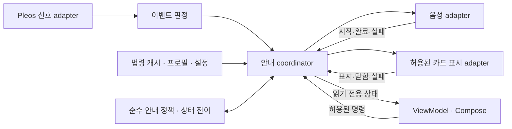

# DRIVE RULE Android 구조

2026-11-15 · [결정 A01](decisions/A01-android-guidance-architecture.md) · [결정 A02](decisions/A02-local-profile-and-ui-demo.md) · [결정 A03](decisions/A03-vehicle-signal-host.md) · [결정 A04](decisions/A04-event-guidance-policy.md) · 단일 `:app` 모듈

앱 코드·빌드·개발 README는 `android/`, 설계·검증·Android 전용 결정은 `docs/android/`에서 관리한다. 공유 루트 README의 통합 작성은 마지막 단계로 남긴다.

화면에는 **MVVM + 단방향 상태 흐름(UDF)**을 사용하고, 주행 안내에는 **화면과 수명을 분리한 실행 조정과 명시적인 상태 전이**를 사용한다. 프로필·법령 캐시는 Repository를 통해 차량 내부에 보관하며, Pleos SDK는 adapter로 격리한다. 이름 등록 같은 단순 기능에는 공통 MVI 프레임워크나 형식적인 UseCase를 추가하지 않는다.

## 적용 상태

| 현재 구현됨 | 아직 기능 구현 전 또는 검증 대기 |
|---|---|
| Compose Screen, ViewModel, immutable UiState/StateFlow | 프로필별 확인·안내 이력 |
| 별도 Room 법령 캐시, 카드·회수·조건·토큰 원자적 반영, WorkManager 동기화 | 실제 화면 연결, 캐시 기기 통합 검증 |
| 이름 최초 설정·건너뛰기·최대 3명 추가/선택, Room 저장 | 이름 수정·삭제와 이력 보존/삭제 정책 |
| 최초 권한 안내 완료 저장, Room v1→v2 migration, 가능한 속도·알림 런타임 권한 요청 | 기기별 권한 허용·철회/재허용·늦은 callback 동작 검증, Gleo 연동 |
| Pleos 온디바이스 이름 STT adapter와 화면 수명에 따른 시작·종료 | 실제 차량의 한국어 음성 인식 성공·품질 검증 |
| DataStore 테마 저장, 최초 설정·권한 안내·더미 홈 라이트/다크 화면 | 실제 차량의 디자인·물리 크기·분할창 검증 |
| Repository/UX provider 인터페이스, AppContainer 수동 주입 | 추가 상황 입력·실제 trip 경계·기기 복구 검증 |
| 실제 CarUxRestrictions·기어·속도·시동·주차 브레이크와 NaviHelper 신호 adapter | 기기별 지원·내비 신호 공급·실제 UX 전환 검증, 사용자 정의 외부 카드 surface |
| Unknown/Restricted 입력·상세 제한, 명시적 Debug 샘플 옵션 | 제품 단계의 기능별 UX·음성/표시 허용 정책 |
| Pleos 온디바이스 TTS·포커스·취소, debug 자동 종료 배너 | 실제 음성 출력·타 앱 전면 팝업 노출·내비 공존 검증 |
| 순수 coordinator, 기본 Debug/Release 실제 신호 FGS host, 별도 opt-in 샘플 | 실제 내비 앱·절전·실차 수신 검증 |
| 단일 app 빌드와 CI 설정, JVM·Room 계측 테스트 작성 | 현재 변경의 검증 결과는 별도 구현 기록에서 관리 |

UI·프로필의 최초 검증은 [2026-11-12 구현 기록](history/ui-implementation-2026-11-12.md), 법령 캐시는 [동기화 기록](history/law-card-sync-2026-11-15.md), 현재 실제 신호·UX·host는 [차량·백그라운드 연결 기록](history/vehicle-background-integration-2026-11-15.md)을 따른다. 4번에서 우회전 이벤트와 검수 카드의 시점·우선순위·시도 예약·출력을 연결했다([기록](history/event-guidance-2026-11-15.md)). 이번에도 기기를 실행하지 않는다. 추가 상황 입력, 5번 실제 화면·운전자별 이력, 6번 설정·기기 검증이 남아 있다. 아래 전체 안내 흐름도와 상태표는 구현된 출력 경계와 앞으로 연결할 법령 정책을 함께 나타내며, 모든 경로가 실행된다는 뜻은 아니다.

## 서비스에 맞춘 책임

| 흐름 | 담당 | 핵심 규칙 |
|---|---|---|
| 이름 등록·운전자 선택 | `feature/profile` + profile Repository | 이름만, 최대 3명, 건너뛰면 기본 운전자. 제한 중 입력 차단. 저장 한도는 UI뿐 아니라 저장 트랜잭션에서도 보장. |
| 최초 권한 안내 | `PermissionGuideScreen` + `DriverFlowViewModel` + 권한 요청 경계 + profile Repository | ‘확인하고 시작’은 가능한 dangerous 권한 요청, ‘나중에’는 요청 없음. 완료 영속화·미완료 복원과 OS 권한 부여를 구분. |
| 음성 이름 입력 | `VoiceDriverOnboarding` + `NameSpeechController` → `NameSpeechEngine` | 빈 이름 화면 진입 시 RESUMED·UX 허용 조건에서 한 번 자동 시작. 직접 입력 보호, 중지 후 명시적 재시도. 최종 결과만 입력란에 반영하고 ‘다음’으로 저장. |
| 출발 전 안내 | `feature/predeparture` + 카드/확인 이력 Repository | 캐시의 검수된 게시 사본 사용. 조회 실패와 빈 결과를 구분하고 프로필별 확인 이력 반영. |
| 실제 차량·내비·UX 수신 | `VehicleMonitoringRuntime` → `core/platform/vehicle` / `core/platform/pleos` → `domain/vehicle` | UI/FGS 소유권·SDK 수명·값 가용성·단위·수신/원본 시각을 보존. 이벤트 생성·법령 매칭은 하지 않음. |
| 신호 → 안내 후보(4번) | `domain/vehicle` → `domain/event` | 신선한 실제 입력만 사용하고 지원되지 않는 상황을 추정으로 확정하지 않음. |
| 안내 선택·상태 변경 | `domain/event` + `domain/guidance` | 게시/회수, 시점, 중복, 우선순위, 채널별 허용을 명시적으로 판단. |
| 타이머·음성·카드 실행 | `app/guidance` → 출력 port → `core/platform` | 한 실행 조정자가 상태를 변경. UI 재구독으로 실행을 시작하지 않음. |
| 설정 | `feature/settings` + 설정 Repository | 설정을 바꾸면 진행 중 안내에도 정책 적용. 음소거를 지원 상실과 구분. |

`decision_json`은 검수된 조건별 문구 선택에만 사용한다. 이벤트 trigger DSL로 쓰지 않는다. 프로필·위치·안내 이력은 서버에 보내지 않으며, 서버 결정 006의 대표 topic 정책과 007의 초안 상태를 구분한다. 서버 wire 계약은 앱 API v1 및 schema 2를 따른다.

## 폴더와 의존성

```text
android/app/src/main/java/com/jochana/driverule/
  app/
    AppContainer.kt           구체 구현 생성과 주입
    DriveRuleApp.kt            화면 연결
    guidance/                 coordinator·VehicleMonitoringRuntime, 수명·타이머 조정
  feature/
    profile/                  이름 등록·선택, 최초 권한 안내, 화면 수명의 이름 STT controller
    home/                     화면 전용 샘플 홈 모델·화면
    predeparture/             Route / Screen / ViewModel / UiState
    driving/                  안내 상태 표시, 허용된 사용자 동작 전달
    settings/                 설정
  domain/
    repository/               저장소 port
    profile/                  이름 검증·프로필 변경 결과
    vehicle/                  실제 차량·내비 관측/UX port, 가용성·수명 정책
    speech/                   이름 STT engine 계약·오류
    event/                    순수 이벤트 판정
    guidance/                 순수 정책·상태 전이, 안내 관찰/명령 및 출력 port
  core/
    model/                    실제로 공유하는 앱 모델·단위
    data/
      repository/             저장소 구현
      local/profile/          프로필 Room Entity / DAO / Database
      local/law/              법령 캐시 DB / 병합 정책 / 카드 검증
      local/guidance/         백업 제외 로컬 시도 예약 파일 / 원자 교체
      remote/                 앱 API client / wire DTO
    platform/
      vehicle/                AAOS 실제 차량 property·UX 제한 adapter
      background/             VehicleMonitoringService / 실제 host
      sync/                   WorkManager 카드 동기화 예약·실행
      pleos/                  NaviHelper 읽기 전용 신호 adapter(위치 미구현)
      audio/                  Pleos ON_DEVICE TTS / audio focus / 취소 경계
      speech/                 PleosNameSpeechEngine, ON_DEVICE 이름 인식
      presentation/           공식 지원이 확인된 카드 표시 adapter
  ui/theme/                   공통 색상·글꼴·간격·모양
  ui/components/              공통 앱 창·헤더·버튼·asset 표시
```

- `feature` → `domain` 인터페이스/순수 로직과 공유 모델. 화면별 UiState는 해당 feature가 소유한다. 다른 feature의 ViewModel을 참조하지 않는다.
- `domain` → 플랫폼과 무관한 Kotlin 타입과 필요한 Coroutine/Flow 계약. Android·Compose·Pleos·Room·네트워크 DTO·`app`을 참조하지 않는다.
- `core/data`, `core/platform` → `domain` 인터페이스를 구현한다. 저장 형식과 SDK 타입을 UI에 노출하지 않는다.
- `app/guidance` → domain 정책·port에 의존한다. 구체 TTS/카드 adapter, Activity, Screen을 직접 참조하지 않는다.
- `app/AppContainer`는 구체 구현을 선택하는 조립 위치다. feature와 runtime에는 필요한 인터페이스만 주입한다.
- 도메인 모델은 우선 기능 가까이에 둔다. 실제 여러 경계가 공유하는 타입만 `core/model`로 올린다. `RuleCardSummary`는 현재 화면 요약이며 확정된 API DTO가 아니다.
- `feature/home/HomePreviewEntry`는 이번 샘플의 표시 전용 모델이다. 법령 API DTO·게시 카드·실제 주행 이력으로 사용하지 않는다.

`src/debug`와 `src/release`의 `app/AppEnvironment`가 주입 환경을 분리한다. 기본 Debug와 Release 모두 실제 UX와 실제 host를 사용하며 공유 라이브러리·UX가 없으면 Unknown 제한을 유지한다. Debug 홈에는 표시용 fixture가 남고 Release에는 샘플 목록·발생기가 없다. `-PdriveRuleSampleMode=true`를 명시한 Debug에서만 주차 UI 가정과 기존 합성 이벤트·TTS·배너 시연을 선택한다. Release에는 이 옵션이 적용되지 않는다. 과거 기본 debug 주차 가정은 현재 기본 모드가 아니다.

패키지 분리는 컴파일러가 강제하는 Gradle 모듈 경계가 아니다. 변경 리뷰에서 import 방향을 확인한다. 별도 배포·병렬 개발·빌드 병목 등 실질적 필요가 생기면 모듈을 나눈다.

## 화면 상태 관리

Route/앱 조립 화면은 ViewModel 생성·연결과 lifecycle에 맞춘 상태 수집을 맡는다. Screen은 표시 상태와 callback만 받아 그린다. `DriverFlowViewModel`은 `changeName`, `saveName`, `skip`, `selectProfile`, `completePermissionGuide` 등 명시적인 함수로 입력을 처리하고 Repository 결과를 UiState로 변환한다. 복잡한 화면만 Action/reducer 도입을 검토한다.

저장이 중요한 상태는 Room/DataStore가 소유한다. 프로필·현재 선택·최초 권한 안내 완료는 Room, 시스템/라이트/다크 선택은 DataStore에 저장한다. 입력 중인 이름은 ViewModel의 임시 상태이므로 프로세스 종료 후 자동 복원하지 않는다. 한 번 표시할 메시지도 처리 결과를 상태로 표현해 화면이 없는 동안 유실되는 일회성 신호에 의존하지 않는다.

`RoomDriverProfileRepository`는 이름을 trim하고 20 Unicode code point 이내인지 검사한다. 이 숫자는 화면 구현용 임시 한도이며 서버 계약이 아니다. 생성·선택은 트랜잭션으로 처리하며 최대 3명 한도를 저장 시점에도 확인한다. `driver_profile(id, name, last_selected_at)`은 기존 ERD 필드를 따르고, 현재 선택은 Android 전용 `local_profile_selection` singleton/FK에 기록해 시스템 시계 역행에 영향을 받지 않는다. 공유 ERD나 백엔드 스키마를 변경하지 않는다. DB는 v1부터 schema를 내보내며 현재 v2에는 `local_onboarding_state(singleton_id, permission_guide_completed)`를 추가했다. 읽기 오류를 빈 프로필로 바꾸지 않으므로 DB 실패가 신규 등록 화면으로 오인되지 않는다.

최초 등록·건너뛰기는 `이름 등록 → 권한 안내 → 홈`으로 연결된다. 첫 프로필 생성과 안내 미완료 상태를 같은 트랜잭션에 기록한다. ‘확인하고 시작’은 기기에서 요청 가능한 `CAR_SPEED`와 API 33+ `POST_NOTIFICATIONS`를 요청하고 거부·취소해도 안내를 완료할 수 있다. ‘나중에’는 OS 요청 없이 진행한다. 제한 전환·프로필/화면 변경 뒤 이전 callback이 안내를 완료시키지 않게 한다. 미완료 상태는 재시작 후 복원하고 저장 실패 시 안내에 남는다. 이후 추가 등록은 안내를 반복하지 않는다. `MIGRATION_1_2`는 v1 기존 등록자의 안내를 완료로 처리한다. 안내 완료는 Android 권한 상태가 아니며 실제 권한은 별도로 재조회하고 홈에서도 요청할 수 있다.

주행 안내를 `LaunchedEffect(uiState)`나 ViewModel의 collector 시작 시 재생하지 않는다. UI는 읽기 전용 상태를 관찰하고 허용된 명령만 전달한다. 실제 UX adapter가 원본 restriction을 보존하고 `VehicleUxState`로 현재 비DO 입력·상세 화면의 보수적인 제한을 요약한다. requiresDistractionOptimization 또는 active restriction이 있으면 제한하며 초기값 미수신·연결 유실은 Unknown이다. 속도 0/P로 허용하지 않고 `Unrestricted`를 음성·모든 표시 surface의 포괄 실행 허가로 사용하지 않는다.

## 음성 이름 입력의 책임과 수명

`AppContainer`는 `NameSpeechEngine` factory를 제공하고 `core/platform/speech/PleosNameSpeechEngine`이 Pleos SDK 타입을 감춘다. `VoiceDriverOnboarding`은 화면 수명의 `NameSpeechController`를 만들고, controller는 연결·수음·최종 결과 대기·오류 상태와 취소를 관리한다. 음성 이름 입력은 아래의 장기 주행 안내 coordinator와 별개인 짧은 화면 작업이다.

최초·추가 등록의 빈 이름 화면은 `RESUMED`와 UX 허용 조건을 만족할 때 화면 세션당 한 번 인식을 자동 시작한다. 직접 입력한 이름은 자동 인식으로 덮어쓰지 않는다. 중간 텍스트는 상태 영역에 표시하고 최종 결과만 `changeName`에 전달한다. 인식 결과가 곧 프로필 저장을 뜻하지 않으며 사용자가 ‘다음’을 눌러 확정한다. 취소·직접 입력·이름 화면 이탈·앱 `ON_PAUSE`/`ON_STOP`·UX 제한 전환에서 세션을 종료하고, 세대가 지난 callback은 입력값을 바꾸지 못한다. 같은 화면 세션에서 복귀해도 자동 재개하지 않고 중지·타임아웃 뒤에는 ‘다시 말하기’로 명시적으로 재시도한다. 미지원·권한 실패·무음·타임아웃은 오류 상태로 제공하며 직접 입력을 유지한다. 로컬 엔진 준비는 최대 45초, 첫 ready 이후 청취는 최대 20초로 분리하고 중복 ready는 시간을 연장하지 않는다. 에뮬레이터 냉시작의 약 26초 준비 관측과 검증 범위는 [권한 안내·음성 입력 검증](history/onboarding-permissions-speech-2026-11-12.md)에 기록했다.

adapter는 [SpeechToText 3.3.1의 `Mode.ON_DEVICE`](https://document.pleos.ai/docs/pleos-only/connect-sdk-pleos/SpeechToText/intro)와 [`Locale.KOREA`](https://document.pleos.ai/docs/pleos-only/connect-sdk-pleos/SpeechToText/set-locale)를 사용한다. SDK 기본값인 HYBRID 또는 서버 인식으로 전환하지 않는다. [`request()`/`stop()`](https://document.pleos.ai/docs/pleos-only/connect-sdk-pleos/SpeechToText/start-and-stop), [최종 결과 구분](https://document.pleos.ai/docs/pleos-only/connect-sdk-pleos/SpeechToText/result-listeners), [listener 제거·release](https://document.pleos.ai/docs/pleos-only/connect-sdk-pleos/SpeechToText/initialization-and-release)를 adapter 내부에서 처리한다.

[`pleos.car.permission.STT_SERVICE`](https://document.pleos.ai/docs/pleos-only/connect-sdk-pleos/SpeechToText/declaring-permissions)는 대상 Pleos 환경의 normal 권한이며 별도 OS 허용 팝업이 없다. 권한 안내의 차량 속도·알림 런타임 요청과 구분한다. 앱이 직접 녹음하지 않고 원본 오디오·인식 결과를 앱 로그나 질문 이력으로 저장하지 않는다. 백엔드 API 준비로 앱 `INTERNET` 권한은 선언했지만 음성 adapter는 계속 `Mode.ON_DEVICE`를 사용한다. 실제 장치에서의 서비스 가용성·한국어 인식 성공·품질은 통합 검증 기록에서 별도로 확인한다.

## API·법령 캐시 경계 — 2026-11-15

`AppContainer.backendApi` → `core/data/remote/BackendApiClient` → Retrofit/OkHttp 순서로 통신한다. 클라이언트 생성이나 캐시 Flow 수집만으로 요청하지 않으며 `RoomDriverProfileRepository`에는 연결하지 않았다. 2026-11-13 사용자 확인에 따라 등록은 차량 내부 Room 저장으로 유지한다. 현행 서버에는 사용자 등록 API가 없으며 이름·프로필 ID를 전송하지 않는다. 프로필 DB 스키마·migration·입력/권한 안내 흐름은 유지한다.

DTO는 wire 형식이며 domain 모델이 아니다. JSON 추가 필드는 무시하고 enum 문자열 및 decision JSON을 보존하지만, 알 수 없는 카드 유형·schema를 실제 안내에 사용할 수 있다는 뜻은 아니다. `LawCardValidator`와 병합 정책이 검증한 지원 사본만 `CachedLawCard`로 제공한다. `CachedRuleCardRepository`는 별도 `drive-rule-law-cache.db`의 카드·회수·조건·토큰을 원자적으로 반영하고 조회한다. 최초 동기화 전 Unavailable과 성공한 빈 catalog를 구분하며, 최근 동기화 실패는 마지막 성공 사본을 지우지 않는다.

`MainActivity → LawCardSyncScheduler → LawCardSyncWorker`가 앱 진입 시 프로세스당 한 번과 24시간 주기 작업을 예약한다. 저장소의 Mutex가 요청부터 저장까지 직렬화한다. 3번에서 시동 관측을 추가했지만 동기화 trigger로 연결하지 않았다. 홈·상세·출발 전 안내의 실제 데이터 전환과 운전자별 확인·안내 이력은 후속 작업이다. API 통신 준비 경위는 [연동 준비 기록](history/backend-api-preparation-2026-11-13.md), 현재 저장·예약·실패 처리와 검증 범위는 [법령 카드 동기화](history/law-card-sync-2026-11-15.md)를 따른다.

## 실제 신호와 host 수명 — 작업 3

`AppContainer → VehicleMonitoringRuntime → AaosVehicleSignalSource / PleosNavigationSignalSource`로 조립한다. `VehicleBackgroundGuidanceHost`는 보이는 Activity에서 시작을 요청하고 `VehicleMonitoringService`가 화면 밖 구독을 소유한다. Compose 상태 수집은 SDK나 음성을 시작하지 않는다. UI와 FGS 소유권을 나눠 서비스가 중지돼도 화면이 보이면 UX 구독을 유지하며, Activity 재생성으로 구독을 중복 만들지 않는다.

AAOS 관측은 UX·기어·부호 있는 속도(m/s)·시동·주차 브레이크다. UX 읽기는 속도/기어 권한과 독립적이다. NaviHelper 3.0.5는 안내/경로 상태·TBT·주의 지점·카메라·보고 제한속도를 앱 타입으로 변환한다. 원문·POI ID·좌표·목적지는 보관하지 않으며 `rawReportedRoadSpeedLimit`는 단위 확인 전 속도 비교에 쓰지 않는다. [신호 계약과 공식 근거](history/navigation-signals-evidence-2026-11-15.md)를 따른다.

권한 거부·미지원·미수신·오래됨을 0/false로 바꾸지 않는다. 속도 5초·내비 관측 10초 만료와 내비 초기화 15초 제한은 기기 검증 전 초기값이다. 연결 중 경로 상태는 5초마다 읽되 실제 응답을 받은 경우에만 routeActive 관측 시각을 갱신한다. 미응답·미갱신 내비 관측은 Stale이며 false로 바꾸지 않는다. on-change 기어·시동·UX는 변화가 없다는 이유로 만료하지 않으며 연결 유실·권한 철회 시 무효화한다. 늦은 callback은 실행 세대를 대조한다.

실제 host는 `specialUse` FGS, 상시 알림과 중지 action을 사용한다. 사용자 중지는 차량 내부에 보존되고 재진입으로 자동 해제되지 않는다. 종료는 `Stopping → onDestroy → Stopped`로 진행해 빠른 재시작 경합을 막는다. 숨은 상태에서 구독 유지 근거가 없으면 30초 유예 뒤 종료하며 유효한 시동 Off/Lock은 유지 근거보다 우선한다. 30초·0.1m/s 등 유지 정책의 초기값은 trip 경계나 법령 이벤트 판정이 아니다. 부팅 receiver·sticky 복구·alarm·wake lock을 추가하지 않았고, 종료 뒤 숨은 상태의 새 출발은 자동 감지하지 않는다.

CAR_SPEED와 API 33+ 알림은 가능한 경우 런타임 요청하며 CAR_POWERTRAIN/NAVI_ROUTE는 normal 선언·실제 grant를 확인한다. 알림 거부가 신호 구독을 막지 않는다. 권한 변화는 process 단위 fingerprint로 재조회하고 재허용 시 새 구독에서 초기값을 받는다. 이번 구현은 신호 연결 기반이며 실제 사용자 기능·FGS 용도·Pleos 배포 승인·기기 동작을 증명하지 않는다. 자세한 구현과 미검증 항목은 [현재 연결 기록](history/vehicle-background-integration-2026-11-15.md)을 따른다.

## 주행 안내 흐름과 실행 수명

아래 화살표는 런타임 데이터 흐름이며 import 의존성과 다르다.



`app/guidance`의 coordinator는 활성 안내 세션마다 하나만 존재한다. 앱의 서로 다른 화면/진입점에서 시작하더라도 같은 세션을 중복 생성하지 않는다. 모든 입력과 완료 callback은 한 순서로 처리하여 상태를 변경한다. 실제 서비스의 VehicleEventGuidance가 EventGuidanceController·GuidanceCoordinator를 소유하며, 순수 DrivingEventDetector/GuidancePlanPolicy와 영속 예약을 연결한다. 순수 판단은 현재 상태·입력·시간값을 받아 다음 상태와 실행 명령을 계산하고 직접 SDK/DB/타이머를 호출하지 않는다.

직렬화 대상은 상태 변경과 명령 발행이다. DB/I/O·음성/카드의 완료를 기다리느라 입력 처리를 막지 않는다. 외부 작업 결과는 안내 ID·실행 세대를 가진 입력으로 되돌리고, 대기 중에도 취소·회수·권한 변화를 처리한다. 실행 전 로컬 예약이 필요한 명령은 예약 성공 결과와 최신 허용 상태를 확인한 뒤 발행한다.

coordinator는 실행 host가 제공하는 명시적인 scope와 시작/종료 수명을 따르며 화면 ViewModel의 scope를 쓰지 않는다. `Application` 객체 보관이나 별도 CoroutineScope가 백그라운드 실행 허가를 뜻하지 않는다. 실제 신호 서비스/host는 위 3번 수명으로 구현했고 음성·표시 surface의 기기·배포 허용은 별도로 확인한다. 종료 시 listener·타이머를 해제하고 자기 안내의 음성·카드를 정리한다.

| 소유자 | 소유하는 상태 | 종료·복구 책임 |
|---|---|---|
| 화면 ViewModel | 표시 상태, 아직 저장하지 않은 입력 | 화면 수명에 맞춰 수집. 필요시 초안 복원. 주행 안내 음성 실행 수명을 소유하지 않음. |
| 차량 runtime / FGS host | UI/서비스 구독 소유권, 실제 신호 상태, 중지/미사용 수명 | 보이는 Activity에서 시작, 사용자 중지 보존, 미사용 정리. 화면 재생성으로 중복 구독하지 않음. |
| 활성 안내 coordinator | 안내 ID, 채널 상태, 타이머, 실행 중 명령 | 명시적인 세션 시작/중단. 앱 화면 복귀만으로 이전 안내 재생 금지. |
| 로컬 Repository | 프로필, 검수 카드 사본/회수, 확인·안내 기록 | 트랜잭션·migration, 프로세스 재생성 후 재조회. 개인정보 외부 전송 없음. |
| 플랫폼 adapter | SDK 연결/listener와 실제 출력 핸들 | 연결/권한 실패를 보고하고 중단 시 정리. 정책을 독자적으로 재시도하지 않음. |

## 안내 상태 전이 규칙

개념 상태는 `Idle → Eligible → Starting → Presenting → Closed`다. 시작 전에는 `Suppressed`, 시작 후 중단에는 `Cancelled` 또는 `Failed`와 사유를 기록한다. 음성·카드는 따로 `NotRequested/Starting/Active/Completed/Failed/Cancelled`를 갖는다. 구체 Kotlin 타입과 저장 스키마는 첫 구현에서 확정한다.

| 입력/상황 | 처리 규칙 |
|---|---|
| 신선한 이벤트 후보 | 현재 게시 사본, 프로필, 시점, 중복, 우선순위, UX/권한 및 출력 지원을 평가. 통과한 후보만 Eligible로 전환. |
| 실행 시작 | `guidanceId`와 세션/실행 세대값을 부여. 실행 직전 최신 조건 재확인. 한 번에 활성 음성 1개·카드 1개, 기존 자원 종료 전 다음 안내 실행 금지. |
| 출력 요청 수락 | 요청 수락과 실제 음성 시작/카드 표시 성공을 구분. 성공 callback을 받은 채널만 Active로 전환. 지원 API가 실제 시작을 알려주지 않으면 추정 상태와 한계를 명시. |
| 음성/카드 완료 | 각 채널을 따로 종료. 같은 안내의 다른 채널 완료로 간주하지 않음. 요청한 모든 채널이 종료돼야 안내 종료. |
| 자동 닫힘 | coordinator가 표시 최대8초와 이벤트/음성 기한을 소유한다. 후보최대30초·예상도착 전 종료·문장 길이 추정을 적용한다. 화면 전환은 최초 표시 기한을 연장하지 않는다. 실차 조정 전 개발값은 결정 A04를 따른다. |
| 회수·만료·관련 권한 상실 | 관련 후보/명령을 무효화하고 해당 안내 출력 취소. 실행 중 회수된 문구를 재시도하지 않음. UX/포커스/음소거 변화는 채널별 허용에 따라 중단. |
| 경로·프로필 변경 | 안내의 관련 맥락을 무효화하는 경로 변경이면 후보/활성 안내를 취소하고 재평가. 단순 ETA 갱신을 새 사건이나 자동 취소로 취급하지 않음. 프로필 전환 시 이전 안내를 종료해 운전자별 이력이 섞이지 않게 함. |
| 늦은 callback/타이머 | 안내 ID와 실행 세대가 맞지 않으면 현재 상태를 변경하지 않음. 취소 후 실제로 열린 출력은 adapter에서 정리하도록 보장하며, 단순히 callback만 무시하고 남겨 두지 않음. |
| 새 후보와 취소 동시 도착 | 상태 변경을 직렬화. 취소/회수/권한 이벤트는 신호 샘플 병합 과정에서 버리지 않음. 새 안내 시작 직전 다시 유효성 확인. |
| 실패/통신 단절 | 유효한 로컬 사본이 있을 때만 안내. 음성 실패 시 카드만 유지할지 등 부분 실패 정책은 허용된 채널 조합에 따라 명시. 재연결로 지난 이벤트를 뒤늦게 재생하지 않음. |

음성 시작·카드 표시·종료는 실제 확인된 채널 상태만 기록한다. 자동 종료나 음성 완료는 명시적 사용자 확인으로 변환하지 않는다. 포커스 복구 시 중단된 음성은 자동 재개하지 않는다. 현재 후보 대기열은 없으며 활성 안내가 있으면 새 접근을 소비한다. 회수·차단·변경은 출력 중에도 처리한다.

한 안내의 음성·카드는 같은 카드 ID/버전의 검수된 내용 스냅샷을 사용한다. 안내 도중 캐시가 갱신됐다고 새 제목과 이전 음성 문장을 섞지 않는다. 카드 ID에 대한 회수는 진행 중 사본에도 적용한다. 취소·출력 정리 자체가 실패하면 상태를 정상 종료로 꾸미지 않고 후속 실행을 보류하며 장치 복구 규칙을 적용한다.

## 중복과 복구

- 이벤트 발생 식별자/구간과 로컬 중복 키 `profileId + cardId + 시행 단계`를 구분한다. 검수 사본은 version을 포함한 전체 동등성으로 확인하지만 버전 교정만으로 중복 제한을 해제하지 않는다. 경로 revision이 바뀌어도 영속 시도 제한은 유지된다. 안내 ID, trip ID, 서버 카드 ID는 서로 다르며 프로세스 재시작을 새 trip으로 판단하지 않는다.
- DB 기록과 SDK 출력은 하나의 원자적 트랜잭션이 아니다. 정확히 한 번 재생을 보장한다고 주장하지 않는다. 실행 전 최소 로컬 예약/중복 기록을 남기고, 종료가 불명확한 시도는 복구 시 자동 재생하지 않는 방향으로 구현한다. 이 선택은 장애 시 안내가 누락될 수 있으나 불확실한 중복 재생을 줄인다.
- 복구 시 캐시·회수 상태·프로필·설정을 다시 읽고 신선한 차량 신호를 확보한다. 이전 in-flight 작업·타이머·TTS를 복원하지 않는다. 시도는24시간/최대128개, 프로필60초 간격·24시간2회로 제한한다. 이는 trip 경계 확정 전의 보수적 대체값이며 [결정 A04](decisions/A04-event-guidance-policy.md)를 따른다.
- 같은 실행 안의 만료/타이머에는 단조 시간을 사용한다. 재부팅 전 단조 시각을 새 부팅과 비교하지 않는다. 법령 시행일은 한국 기준 날짜로 별도 처리한다.
- 현재 `notice_log`와 `card_confirmation`에 실시간 안내 상태를 임의로 끼워 넣지 않는다. 필요한 로컬 기록 스키마·migration·보존 기간은 결정 문서로 추가한다. 분석 서버나 이벤트 소싱 전체 로그는 도입하지 않는다.

## 현재 작업 순서와 완료 기준

최초 설정·권한 안내·Room 프로필·테마·이름 STT·샘플 홈을 기반으로 다음 순서를 따른다. 작성된 코드와 실제 실행 검증을 구분한다.

1. **법령 데이터:** 앱 API와 별도 Room 법령 캐시·WorkManager 동기화 구현.
2. **음성·짧은 안내:** 온디바이스 TTS·포커스·취소와 자동 종료 배너 구현. 명시적 Debug 샘플 시연 경로와 실제 음성·팝업 기기 검증을 구분.
3. **실제 차량·백그라운드:** 차량/내비 신호·CarUxRestrictions·Release host 구현. 이번에는 기기 실행 없이 통합 결과를 별도 기록.
4. **상황별 안내 판단:** 우회전 후보·검수 카드 매칭·시점·중복·우선순위·회수 취소 구현. 학교·목적지 B/H와 FusedLocation·공개 시설 사본을 결정 A05에 따라 추가. 고속도로 A는 입력 확보 전 보류. 가짜 신호/시계/출력으로 경계·경합·늦은 callback·복구 정책 검증.
5. **실제 화면·이력:** 검수 캐시를 홈·상세·출발 전 안내에 연결하고 운전자별 확인/안내 이력 구현. fixture와 실제 기록 구분.
6. **설정·기기 검증:** 내비 공존·권한·UX·주야간·백그라운드·실제 선행 시점·종료/재연결 검증. Gleo 기능 2는 별도 후속 범위 유지.

단순 Repository 전달에는 UseCase를 강제하지 않는다. 복잡하거나 공유되는 정책만 분리한다. BaseViewModel/범용 event bus/전역 mutable store는 만들지 않으며, Hilt·MVI 라이브러리·다중 모듈은 실제 필요가 생길 때 도입한다.

## 참고와 빌드 기준

- [Android 아키텍처 권장 사항](https://developer.android.com/topic/architecture/recommendations), [UI/UDF](https://developer.android.com/topic/architecture/ui-layer), [선택적 domain layer](https://developer.android.com/topic/architecture/domain-layer). 이 프로젝트의 순수 domain과 실행 coordinator 구분은 프로젝트 설계이며 공식 UseCase 수명 모델과 동일하다고 주장하지 않는다.
- [개발 컨벤션](../../android/CODEX_CONVENTIONS.md), [디자인 점검](history/design-compliance-2026-11-12.md), [Pleos 근거 및 지원 확인 기록](history/source-check-2026-11-12.md).
- [AGP 8.7](https://developer.android.com/build/releases/agp-8-7-0-release-notes): Gradle 8.9와 JDK 17 기준. 현재 AGP 8.7.2.
- [Kotlin 호환성](https://kotlinlang.org/docs/gradle-configure-project.html), [Compose compiler](https://kotlinlang.org/docs/compose-compiler-migration-guide.html): Kotlin/Compose plugin 2.1.20.
- [Compose BOM 2024.12.01](https://dl.google.com/dl/android/maven2/androidx/compose/compose-bom/2024.12.01/compose-bom-2024.12.01.pom): Compose 1.7.6/Material 3 1.3.1, AndroidX minCompileSdk 34 확인.
- [Gradle 8.9 SHA-256](https://services.gradle.org/distributions/gradle-8.9-bin.zip.sha256): Wrapper 체크섬 고정.
- 로컬 저장/UI 의존성: Room 2.7.2, KSP 2.1.20-1.0.32, Preferences DataStore 1.1.1, Coil/SVG 2.7.0. Asta Sans와 OFL 원문을 앱에 번들로 포함한다. 실제 버전은 `android/gradle/libs.versions.toml`을 따른다.

현재 조합은 JDK17/SDK34이며 Pleos STT/TTS 3.3.1, NaviHelper 3.0.5, FusedLocation 1.1.3을 사용한다. B/H/I의 법령 선택·출력까지 연결했으며, 고속도로 분류·실제 화면·운전자별 이력과 타 앱 위 사용자 정의 카드 지원은 남아 있다. 위치 수명·공개 학교 사본·순수 공간 판정은 [결정 A05](decisions/A05-school-and-destination-events.md), [Figma 연결 기록](history/spatial-events-2026-11-15.md)을 따른다. 제출 허용·실제 기기 수신·음성 인식/출력은 별도 검증하며 최신 결과는 [현재 연결 기록](history/vehicle-background-integration-2026-11-15.md)을 따른다.

## 백그라운드 이벤트 실행 준비 — 2026-11-13 과거 기록

당시 최초 구현은 debug 전용 `SampleGuidanceService`가 `GuidanceCoordinator`와 타이머 출처를 소유했다. MainActivity.onStart의 host가 한 번 시작하고 Activity.onStop이나 Compose 재구독은 세션을 끝내거나 새로 만들지 않았다. 읽기 전용 runtime은 전체 수신·앱 화면 부재 중 수신·알림 게시를 구분했으며 알림 거부가 이벤트 처리를 중단시키지 않았다.

서비스는 10분 샘플 세션 또는 명시 중지로 종료했다. 실제 차량·TTS·법령 캐시가 미연결이던 당시 범위는 [2026-11-13 실행·검증](history/background-events-2026-11-13.md)에 보존한다. 현재 기본 실행은 실제 host이며 기존 샘플은 `-PdriveRuleSampleMode=true`에서만 선택한다.


## 음성·자동 종료 배너 — 2026-11-15

`GuidanceCoordinator`가 카드 출력과 독립된 음성 Job을 소유하며 교체·만료·세션 종료로 취소한다. `GuidanceSpeechOutput` 뒤의 Pleos adapter는 ON_DEVICE 합성과 오디오 포커스·SDK 정리를 맡는다. 명시적 Debug 샘플 host는 앱 전면의 읽기 전용 배너와 타 앱 전면의 시스템 EVENT 알림에 같은 이벤트의 남은 표시 시간을 적용한다. 화면 구독은 발화를 시작하지 않는다. 이름 입력 중 음성을 억제하고 완료/자동 닫힘을 확인 이력으로 저장하지 않는다. 출력 구현 경계는 [음성·배너 기록](history/voice-and-transient-guidance-2026-11-15.md)을 따른다. 4번에서 실제 우회전 접근과 검수 카드 선택을 같은 출력 경계에 연결했다. [현재 구현 기록](history/event-guidance-2026-11-15.md)을 따른다.
