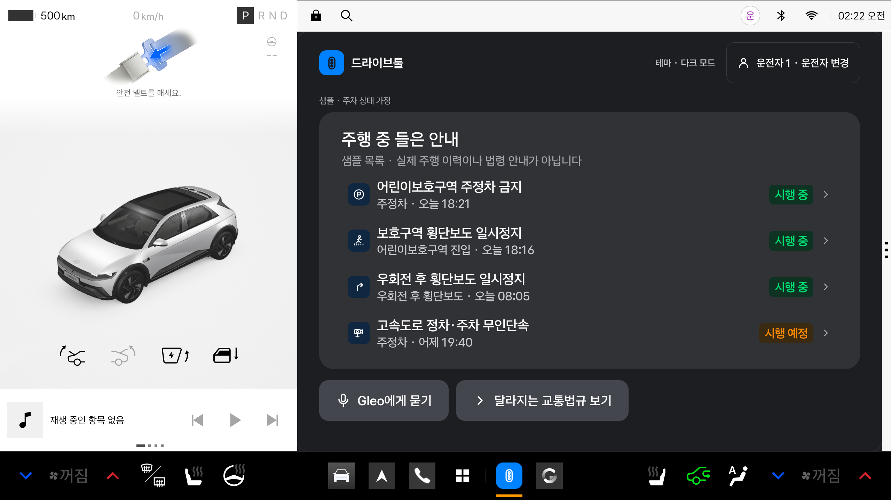

# 런처 아이콘과 Pleos 실행 점검 — 2026-11-12

## 관측한 증상과 복구

Android Studio Run 뒤 독에서 앱을 눌러도 차량 설정 화면이 그대로 남는 현상을 연결된 Pleos Connect v2.1.0 에뮬레이터(API 34, 사용자 10)에서 확인했다.

- `MAIN/LAUNCHER`는 `com.jochana.driverule/.MainActivity`로 정상 해석됐다. 해당 사용자의 앱도 설치·활성 상태였다.
- 앱 Activity는 `RESUMED`, 화면은 `HAS_DRAWN`이고 UI hierarchy에 샘플 홈이 존재했다. 하지만 실제 디스플레이 캡처에는 차량 설정이 남았다.
- 문제가 있던 앱 task의 영역은 `[0,0]–[1682,1350]`이었다. 정상 앱 slot은 `[853,90]–[2535,1300]`이었다.
- 독 탭은 기존 Activity에 전달됐으며, 확인한 crash buffer에 DRIVE RULE의 예외는 없었다.
- 앱만 `force-stop`한 뒤 독에서 새로 실행하자 정상 slot에 홈이 표시됐다. 이어서 `am start -W`의 `MAIN/LAUNCHER` 실행도 성공했다. `운전자 1`과 다크 테마가 유지됐다.

이 관측은 기존 task의 표시·배치 상태 문제를 지지한다. Android Studio 자체 결함이나 Pleos의 알려진 버그로 원인을 확정한 것은 아니다. 앱 데이터 삭제, 에뮬레이터 초기화, 시스템 런처 강제 종료는 수행하지 않았다.

## 재발 시

Android Studio에서 `android/`를 열고 `app` 모듈의 `debug` 변형을 설치한다. 현재 장치에서 앱 아이콘을 눌러도 창이 보이지 않으면 Android 터미널에서 다음을 실행한다.

```powershell
.\scripts\restart-app.ps1
# 연결된 장치가 여러 개이면 adb devices에서 확인한 serial을 지정
.\scripts\restart-app.ps1 -Serial emulator-5554
```

스크립트는 현재 Android 사용자를 조회하고 DRIVE RULE만 종료·재실행한다. Room/DataStore를 삭제하거나 권한·차량 설정을 바꾸지 않는다. 여러 장치가 연결되었는데 serial을 지정하지 않으면 중단한다. `Status: ok`는 Activity 시작 결과이므로 실제 Pleos 앱 창 표시까지 확인한다. 첫 실행에는 이번 장치에서 약 5~6초가 걸렸다.

주행 제한 화면이 뜨는 경우는 이 현상과 별개다. 임의의 `distractionOptimized`, overlay, 특수 launch mode를 넣어 제한이나 창 관리 문제를 우회하지 않는다.

## 아이콘

사용자 제공 `Icon.svg` 원본은 [Android 디자인 에셋](../../../android/design-assets/launcher/Icon.svg)에 보존했다. 80×80, 파란색 `#0082FF`, 흰색 신호등의 경로 4개와 stroke를 Android VectorDrawable로 옮겼다. adaptive 아이콘은 플랫폼 마스크에 맞게 배경과 전경을 분리하며 API 33 이상 monochrome 리소스도 제공한다. Manifest의 `icon`과 `roundIcon`은 `@mipmap/ic_drive_rule`을 참조한다.

원본 SHA-256: `401919d4de3b1bcb2f9a85f5d271d54ef0cce3e877f78bb8812a848fdb8222c6`.

## 대조 근거

- [Pleos 공식 Vehicle 샘플 Manifest](https://github.com/Pleos-Playground/pleos-sample-vehicle-app/blob/main/app/src/main/AndroidManifest.xml): 현재 앱과 같은 기본 `MAIN/LAUNCHER` 진입점. 특별한 launch mode를 요구하지 않는다.
- [Pleos 앱 화면 모델](https://document.pleos.ai/docs/pleos-only/vehicle-app-planning-guide/app-structure-screen-model): 시스템 앱 slot과 창 배치의 기준.
- [AOSP Android 14 ActivityManager](https://android.googlesource.com/platform/frameworks/base/+/refs/heads/android14-release/core/java/android/app/ActivityManager.java): 당시 `START` 결과 3은 `START_DELIVERED_TO_TOP`, 기존 top Activity로 Intent를 전달했다는 뜻이다.

## 추가 확인

- 새 아이콘을 포함한 APK를 현재 사용자 10에 덮어 설치했고, 재실행 스크립트가 `Status: ok`로 완료됐다.
- 앱 목록에서 파란 배경·흰색 신호등 아이콘을 확인했다.
- 차량 설정으로 전환한 상태(`ai.umos.vehiclecontrol`)에서 독 아이콘을 누른 뒤 DRIVE RULE(`com.jochana.driverule`)의 샘플 홈이 다시 표시되는 것을 UI hierarchy와 화면 캡처로 확인했다.
- 원래 프로필과 선택 테마가 유지됐고, 확인한 crash buffer에 DRIVE RULE 예외는 없었다.
- minSdk 28 기준으로 adaptive 리소스를 `mipmap-anydpi`에 통합했다. 별도 v26/v33 변형은 두지 않는다. API 28에서 미지원 monochrome 태그를 건너뛰는 동작은 [AOSP Android 9 구현](https://raw.githubusercontent.com/aosp-mirror/platform_frameworks_base/android-9.0.0_r1/graphics/java/android/graphics/drawable/AdaptiveIconDrawable.java)으로 대조했다.
## 재부팅 후 확인

앱 덮어 설치 직후 앱 목록에는 새 아이콘이 보였지만 독에는 이전 아이콘이 남았다. 에뮬레이터를 데이터 초기화 없이 재부팅한 뒤 독도 새 아이콘으로 갱신됐다. 그 독 아이콘을 직접 눌러 정상 앱 slot `[853,90]–[2535,1300]`에 홈이 표시되는 것과 기존 운전자·다크 테마가 유지되는 것을 확인했다. 재부팅 후 실행에는 복구 스크립트를 사용하지 않았다.



[앱 목록에서 확인한 새 아이콘](../screenshots/launcher/app-grid-icon.png)

Gradle 리소스 변형 통합 직후 증분 빌드에서 아이콘 참조 누락이 발생했으나 `:app:clean :app:lintDebug :app:testDebugUnitTest :app:assembleDebug`는 성공했다. JVM 테스트는 19개가 통과했다. 실제 앱 기능·Activity 실행 속성은 이번 점검에서 변경하지 않았다. 아이콘, 재실행 개발 도구, 검증 문서만 변경했다.

최종 정리 후 :app:lintDebug와 :app:assembleDebug도 성공했다. lint 오류 0개, 기존 버전 업데이트 권고 45개이며 아이콘 경고는 없다. 최종 APK를 덮어 설치하고 serial 자동 선택 방식의 재실행 스크립트까지 성공했다(현재 사용자 10, cold start 약 3.7초). 변경 범위는 Android 코드·문서 폴더 안이며 커밋·푸시는 수행하지 않았다.
