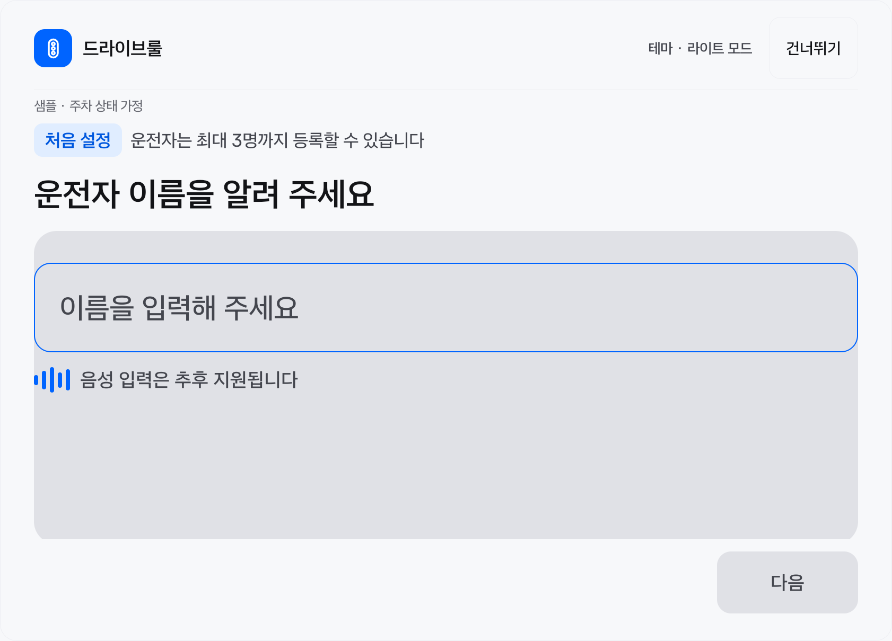
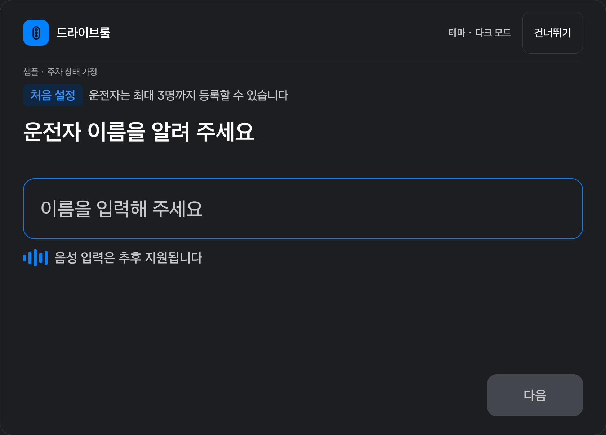
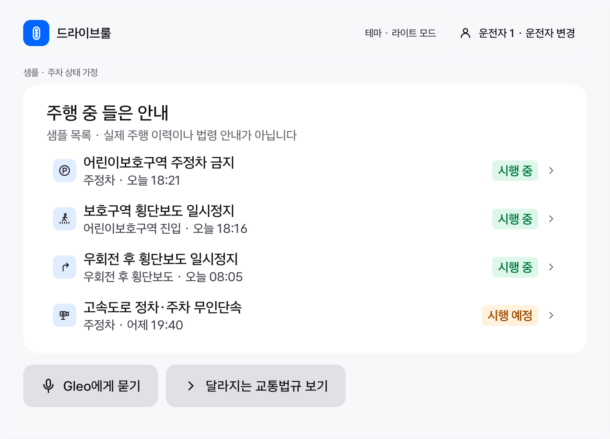
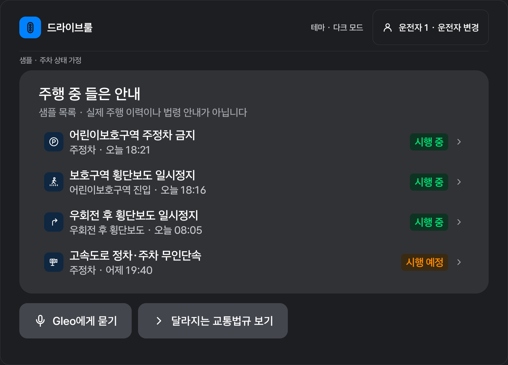
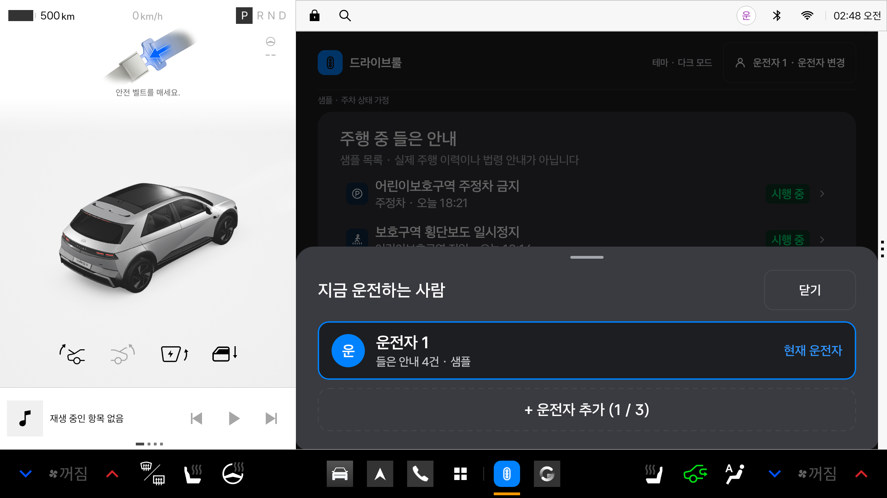
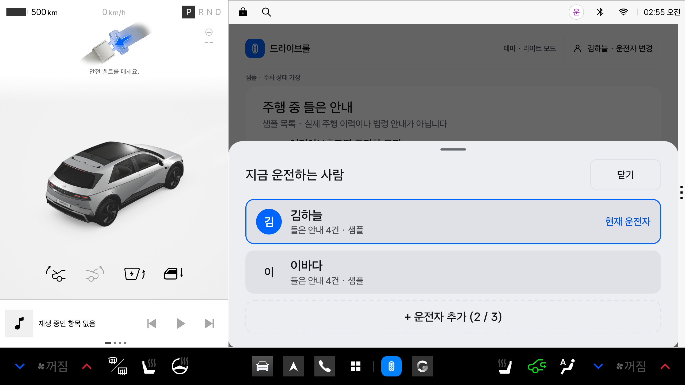
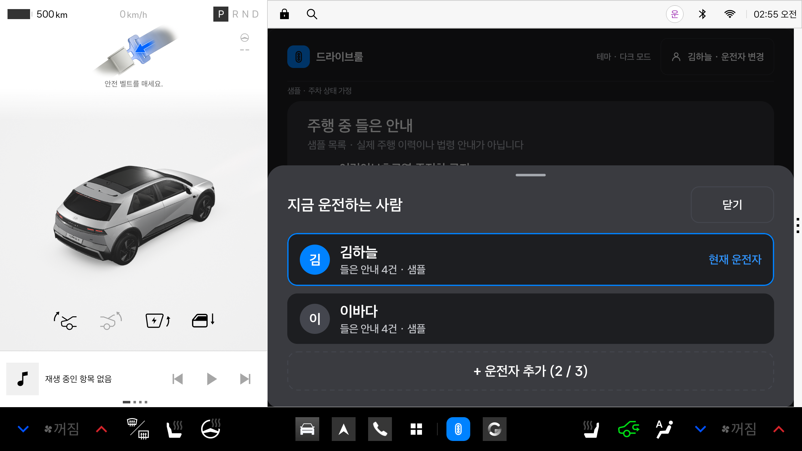
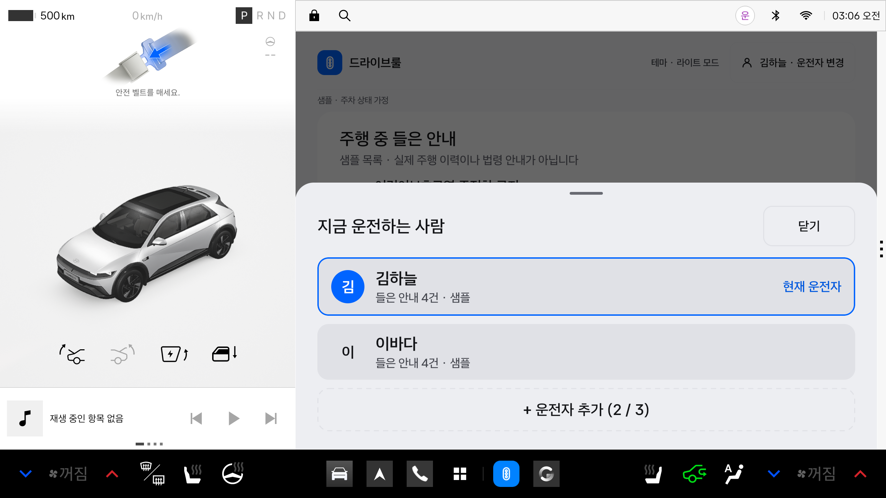
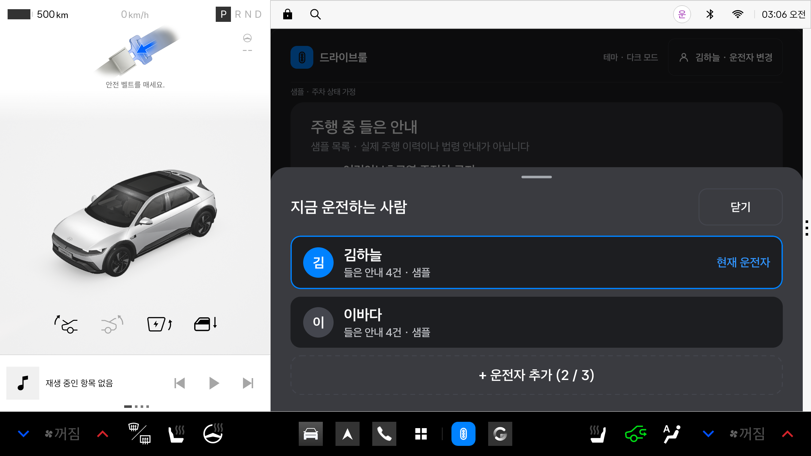

# 최초 설정 → 샘플 홈 구현·검증

2026-11-12 · 범위: Android 앱 창, 로컬 프로필, 더미 홈, 주간·야간 테마.

## 구현

- 처음 실행하면 이름을 입력한다. 앞뒤 공백을 정리하며 빈 이름은 저장하지 않는다. 임시 한도는 Unicode code point 20자다.
- 건너뛰면 `운전자 1`을 만들고 홈으로 이동한다. 운전자는 최대 3명이며 홈에서 추가·선택한다.
- Room v1에 이름과 선택 상태를 저장한다. 생성·선택은 트랜잭션이고, UI뿐 아니라 저장소에서 3명 한도를 검사한다. 이름 수정·삭제는 이번 범위에 없다.
- 시스템/라이트/다크 테마를 선택하고 DataStore에 보관한다. 오류와 저장 중 상태를 표시한다.
- 홈은 디자인의 예시 4건을 보여준다. `HomePreviewEntry`는 UI용 fixture이며 운영 법령 DTO나 실제 주행 이력이 아니다. 상세·변경 법규 버튼에도 샘플임을 알린다.
- 음성 입력과 Gleo는 미연결 안내만 제공한다. 서버·위치·차량·마이크 권한 및 인터넷 권한을 추가하지 않았다. 이름·이력을 외부로 전송하거나 분석하지 않는다.

## 디자인

[Figma 최초 설정](https://www.figma.com/design/dltRYbBH0KHuBe86A6Vr2G/?node-id=1844-33051), [야간 홈](https://www.figma.com/design/dltRYbBH0KHuBe86A6Vr2G/?node-id=1844-32262), [주간 홈](https://www.figma.com/design/dltRYbBH0KHuBe86A6Vr2G/?node-id=1870-31102)을 대조했다. 원본 Asta Sans 4개 weight와 주·야간 SVG 18개를 로컬 번들에 넣었다. 출처·OFL·slot 대응·대비 계산은 [에셋 기록](../figma-assets.md)에 있다.

계기판·차량 시스템 dock·내비 지도는 앱에서 그리지 않는다. 창 너비와 글자 배율에 따라 header/상태 배지/footer를 재배치하고, 긴 내용은 주차 상태에서 스크롤한다. 원본에 없는 테마 선택과 샘플 표시를 추가했다. STT 미연결 상태의 막대는 정적이다.

작은 설정 배지의 글자색을 대비 4.5:1 이상으로 보정했다. Material 다이얼로그의 야간 액션 글자는 `#60A5FF / #313236`(5.07:1), 주간 액션은 `#0058DE`를 사용한다. 입력 placeholder와 비활성 버튼은 secondary 글자색으로 읽기 쉽게 유지했다. 시스템 표시줄과 앱 시작 배경도 주·야간에 대응한다.

### 09 운전자 변경 시트

2026-11-12 추가. 홈의 운전자 변경을 [야간 Figma 09](https://www.figma.com/design/dltRYbBH0KHuBe86A6Vr2G/?node-id=1844-33121)(sheet `1844:33168`)와 [주간 Figma 09](https://www.figma.com/design/dltRYbBH0KHuBe86A6Vr2G/?node-id=1870-31123)(sheet `1870:31149`)의 하단 시트로 구현했다. `DriverChangeSheet`는 앱 창에 속한 Material3 `ModalBottomSheet`를 사용한다. 플랫폼의 하단 safe-drawing inset을 유지한다.

- 실제 저장된 프로필의 이름과 첫 글자를 표시한다. 현재 운전자는 파란 테두리·아바타와 ‘현재 운전자’ 표기로 구분한다.
- 행을 누르면 기존 ViewModel·Room 경로로 운전자를 선택하고 시트를 닫는다. 점선 ‘운전자 추가’는 이름 입력으로 연결하며, 3명에 도달하면 비활성화된다.
- 닫기 버튼이나 시트 밖의 어두운 영역을 누르면 닫힌다. UX 상태가 `Restricted/Unknown`으로 바뀌면 시트가 구성에서 제거되어 프로필 조작을 중단한다.
- 각 행의 ‘들은 안내 N건 · 샘플’은 홈의 공통 더미 목록 개수다. 운전자별 실제 수신·청취 횟수가 아니며 새 이력도 저장하지 않는다. 개수를 제공할 수 없으면 ‘안내 이력 준비 중’으로 표시한다.
- 시트 배경·행·테두리에는 기존 주·야간 토큰을 사용한다. 주간 비선택 아바타 글자는 `textPrimary`, 현재 운전자 글자는 대비를 보정한 기존 `accentText`를 사용한다. 이름 첫 글자는 동적 텍스트이며 새 이미지 에셋을 추가하지 않았다.
- 긴 이름과 큰 글자에서는 현재 운전자 표기를 이름 아래에 배치하고 목록을 스크롤할 수 있게 했다. Figma의 1686.667×777.333px 시트 치수를 Android의 고정 dp나 물리 크기로 간주하지 않는다.

이번 시트의 빌드·기기 검증 결과는 아래 추가 검증 기록에 별도로 남긴다.

## 개발 시뮬레이션과 출시 경계

`src/debug/.../AppEnvironment`만 더미 4건과 `Unrestricted` UX 가정을 공급한다. 화면의 `샘플 · 주차 상태 가정` 표시와 함께 에뮬레이터에서 UI를 개발하는 용도다. 실제 주차 상태를 판별한 것이 아니다.

`src/release/.../AppEnvironment`는 더미 목록을 포함하지 않고 기존 `UnavailableUxRestrictionProvider`를 사용한다. 실제 `CarUxRestrictions` adapter가 연결되기 전에는 입력·상세 화면을 열지 않는다. UI 테스트는 가짜 provider가 Restricted/Unknown으로 바뀔 때 입력과 열린 상세를 제거하는지 확인하며, 실제 차량 신호 연동 검증과 구분한다.

Room 스키마는 `android/app/schemas/`에 버전 관리한다. 최초 v1이므로 이전 버전 migration은 아직 없다. 선택 상태의 Android 전용 테이블 추가는 공유 서버 ERD 변경을 뜻하지 않는다. [결정 A02](../decisions/A02-local-profile-and-ui-demo.md)를 따른다.

## 검증 환경과 결과

- JDK 17, Gradle 8.9, AGP 8.7.2, Kotlin 2.1.20, compile/target 34.
- Room 2.7.2 + KSP 2.1.20-1.0.32, DataStore 1.1.1, Coil 2.7.0. 공식 AAR metadata에서 compile SDK 34 호환을 확인한 뒤 실제 프로젝트에서 컴파일했다.
- Pleos Connect v2.1.0 에뮬레이터: API 34, x86_64, 디스플레이 2560×1440, density 160.

최종 실행 결과와 화면은 아래에 기록한다. 실차의 물리 글자 높이(5mm/3mm), 실제 UX 제한 callback, TTS·백그라운드 카드·Gleo·서버 연동은 아직 검증 대상이다.

참고: [Room 2.7.2 릴리즈](https://developer.android.com/jetpack/androidx/releases/room#2.7.2), [KSP 릴리즈](https://github.com/google/ksp/releases/tag/2.1.20-1.0.32), [Coil 2.7.0](https://coil-kt.github.io/coil/changelog/#270-july-17-2024).

### 최초 설정·홈 검증 결과 — 시트 변경 전

| 확인 | 결과 |
|---|---|
| `lintDebug`, `testDebugUnitTest`, `assembleDebug`, `assembleDebugAndroidTest`, `compileReleaseKotlin` | 성공 |
| JVM 테스트 | 19개 통과: 이름 검증 4, 기존 카드/UX 5, 프로필 흐름/오류 복구 10 |
| 기기 테스트 | 11개 통과: Compose 화면 7, Room 저장소 4 |
| lint | 오류 0. AGP/의존성 버전 업데이트 권고 45건(변형별 중복 포함) |
| 실제 앱 실행 | Pleos MainActivity에서 최초 설정 → 건너뛰기 → 기본 운전자 홈 확인 |
| 프로세스 재시작 | `운전자 1`과 수동 다크 모드가 함께 복원됨 |
| 앱 창 | UI hierarchy 기준 `[853,90]–[2535,1300]`, 1682×1210px |
| 작은 창·큰 글자 | Compose 내부 540dp/글자 배율 1.3/한글 20자 이름에서 프로필·테마·마지막 카드·하단 버튼 조작 통과 |
| 개인정보·권한 | merged manifest에 인터넷/차량/위치/마이크/overlay 권한 없음. backup 비활성 유지 |

초기 `connectedDebugAndroidTest` 10개 통과 뒤 작은 창 시나리오를 추가했고, 최종 APK에서 아래 runner 명령으로 11개가 모두 통과했다. 사용자 10은 이번 Pleos 에뮬레이터의 현재 사용자이며 다른 장치에서는 `am get-current-user` 결과를 사용한다.

```powershell
adb -s emulator-5554 shell am instrument --user 10 -w -r com.jochana.driverule.test/androidx.test.runner.AndroidJUnitRunner
# OK (11 tests)
```

기본 Gradle 검증 방법은 [Android README](../../../android/README.md)를 따른다. 최종 APK 위치는 `android/app/build/outputs/apk/debug/app-debug.apk`다. release는 Kotlin 컴파일만 확인했으며 서명 배포·실차 인증을 수행하지 않았다. 이번 구현 변경은 커밋·푸시하지 않았다.

기기 테스트의 프로필 저장소는 UI 테스트용 메모리 구현이고, Room 테스트는 별도 임시 DB로 동시 생성 한도·입력 검증·없는 ID 선택·DB 재오픈/시계 역행 시 선택 복원을 확인한다. 실제 MainActivity의 Room/DataStore 복원은 위 수동 실행으로 추가 확인했다. 더미 홈을 조회하거나 상세를 닫아도 실제 안내 이력/확인 기록을 만들지 않는다.

검증 캡처는 테스트 앱의 내부 `files/screenshots/`에 생성한다. Pleos 다중 사용자 환경의 외부 저장소 읽기 제한을 피하기 위한 테스트 출력 위치이며 운영 앱 기능을 바꾸지 않는다. 캡처용 시나리오 실행 후 아래 이미지로 보관했다.

### 화면 캡처

| 최초 설정 · 라이트 | 최초 설정 · 다크 |
|---|---|
|  |  |

| 샘플 홈 · 라이트 | 샘플 홈 · 다크 |
|---|---|
|  |  |

[540dp·큰 글자·긴 이름 화면](../screenshots/onboarding-home/home-compact-large-font.png)

원본과 비교한 항목은 앱 영역, header/입력/목록/상태 배지/하단 버튼 배치, 주·야간 배경과 글자색, SVG 표시와 비율, 한글 줄바꿈이다. 실제 차량의 1/2 window 배치 변경과 물리 글자 높이·밝기 검증은 별도로 남긴다.


## 09 운전자 변경 시트 추가 검증

2026-11-12 · 같은 Pleos API 34 에뮬레이터, 사용자 10. 아래 결과는 운전자 변경 시트를 포함한 APK에서 확인했다.

| 확인 | 결과 |
|---|---|
| `lintDebug`, `testDebugUnitTest`, `assembleDebug`, `assembleDebugAndroidTest` | 성공 |
| JVM 테스트 | 19개 통과, 실패·오류·건너뛰기 0 |
| 기기 시나리오 | Compose 12개 + Room 4개 모두 통과 결과 확인 |
| lint | 오류 0, 기존 버전 업데이트 권고 45건 유지 |
| 선택·추가·닫기 | 선택한 프로필로 홈 복귀, 추가 화면 진입, 닫기/바깥 터치 시 선택 보존 |
| 최대 3명 | 추가 비활성, 기존 마지막 프로필 선택 가능 |
| UX 제한 | `Restricted/Unknown` 전환으로 시트 제거, 복구 후 자동 재개 없음 |
| 작은 창·큰 글자 | Compose 내부 540dp·글자 배율 1.3·긴 이름에서 선택/추가/닫기 접근 통과 |
| 실제 MainActivity | 저장된 `운전자 1`과 다크 모드 유지, 시트 열기·바깥 터치 닫기 확인 |
| 앱 창 경계 | 시트·어두운 배경은 앱 slot 안에 표시. 시스템 Driving view/상단 표시줄/하단 dock을 덮지 않음 |

전체 16개 실행에서 15개가 통과했고 바깥 터치 테스트의 좌표 가정 한 건이 실패했다. Material3 1.3.1은 caller modifier 뒤에서 시트 위치를 이동하므로, 외부 `driver_sheet` 태그 대신 이동된 내부 닫기 버튼 좌표를 사용하도록 테스트를 수정했다. 프로덕션 동작은 바꾸지 않았다. 해당 테스트와 주·야간/작은 창 시나리오 3개를 다시 실행해 `OK (3 tests)`를 확인했다.

```powershell
# APK와 androidTest APK를 현재 사용자에게 설치한 뒤 실행
adb -s emulator-5554 shell am instrument --user 10 -w -r com.jochana.driverule.test/androidx.test.runner.AndroidJUnitRunner
# 특정 메서드는 -e class '패키지.테스트클래스#메서드'로 재실행
```

시트 구현은 [Android의 ModalBottomSheet API](https://developer.android.com/develop/ui/compose/components/bottom-sheets)를 사용한다. 기본 bottom safe-drawing inset을 유지하며, 실제 차량의 물리 글자 크기·1/2 window 전환·CarUxRestrictions 연동 검증은 별도로 남긴다. 이번 변경은 커밋·푸시하지 않았다.

### 실제 앱 창 확인




### 시트 주·야간 및 작은 창 캡처

별도 Dialog window를 포함한 합성 화면은 `UiAutomation.takeScreenshot()`으로 촬영했다. 아래 이미지는 테스트용 메모리 프로필 2명을 사용하며 시스템 UI도 포함한다. 이 캡처 방식으로 주·야간/작은 창 테스트 2개를 다시 실행해 `OK (2 tests)`를 확인했다. 시트의 모서리·핸들·제목·닫기·행 간격·선택 테두리·점선 추가 버튼을 원본과 대조했다.

| 라이트 | 다크 |
|---|---|
|  |  |

[540dp·글자 배율 1.3·긴 이름 시트](../screenshots/driver-sheet/driver-sheet-compact-large-font.png)


## 후속 수정: 하단 모서리와 최초 진입 흐름

사용자 요청에 따라 운전자 변경 시트는 상단의 둥근 모서리만 유지하고 하단 좌우 반경을 0dp로 바꿨다. Figma 원본의 하단 반경보다 최신 요청을 우선하며 라이트·다크에 같은 shape를 적용한다.

권한 안내·STT 추가 전 점검 당시 개발용 debug 앱은 활성 로컬 프로필이 없으면 `DriverOnboardingScreen`에서 이름을 등록한다. 건너뛰면 `운전자 1`을 만들고, 저장된 선택 프로필이 있으면 이름 등록을 다시 표시하지 않고 홈으로 이동한다. 이 시점에는 최초 안내 플래그·권한 안내 페이지·음성 입력 SDK가 없었다. 이후 권한 안내와 STT를 연결했으며 최신 상태는 아래 후속 기록을 따른다.

release는 차량 UX adapter 연결 전까지 `Unknown`으로 제한되므로 이름 등록에 앞서 상태 확인 불가 화면을 표시한다. 신규 사용자 확인을 위해 실제 운전자 DB나 테마 데이터를 초기화하지 않는다.


후속 수정 검증: `lintDebug`, `testDebugUnitTest`, `assembleDebug`, `assembleDebugAndroidTest` 성공. JVM 19개 통과, lint 오류 0(기존 버전 권고 45건). 기존 계측 테스트 중 이름 입력→홈과 주·야간 시트 시나리오 2개를 재실행해 모두 통과했다. 아래 새 캡처에서 상단 곡면과 하단 직각을 확인했다. 앞 절의 기존 캡처는 수정 전 기록이다.

| 하단 직각 · 라이트 | 하단 직각 · 다크 |
|---|---|
|  |  |


## 후속 구현: 최초 권한 안내와 Pleos 음성 이름 입력

최초 등록 → 권한 안내 → 홈, 추가 등록 → 홈 및 ON_DEVICE STT를 연결했다. 최신 빌드·흐름·Room v2 migration·실제 서비스 검증과 캡처는 [권한 안내·음성 입력 검증](onboarding-permissions-speech-2026-11-12.md)을 따른다. 위의 권한 안내 없음·STT 미연동 설명은 변경 전 기록이다.

## 현재 UI 재점검

이 문서의 이전 단계 캡처·검사 수는 당시 기록이다. 이름 자동 음성 입력과 권한 안내까지 추가한 현재 화면은 [Figma·Pleos 디자인 재점검](design-compliance-2026-11-12.md)을 따른다. 최신 원본의 시행 예정 배지·버튼 테두리·간격, 긴 이름의 헤더 배치와 글자 대비를 보정하고 최종 UI 검사 9개를 통과했다.
