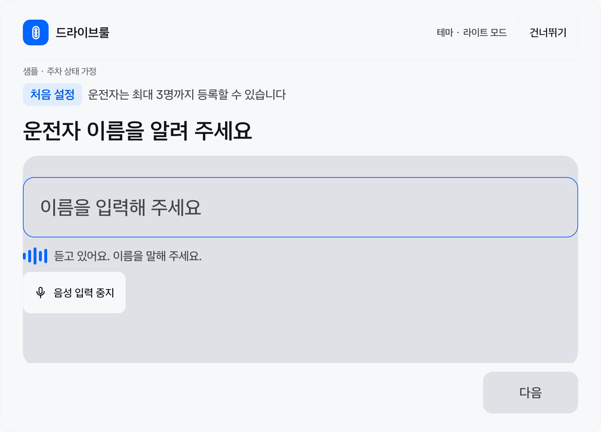
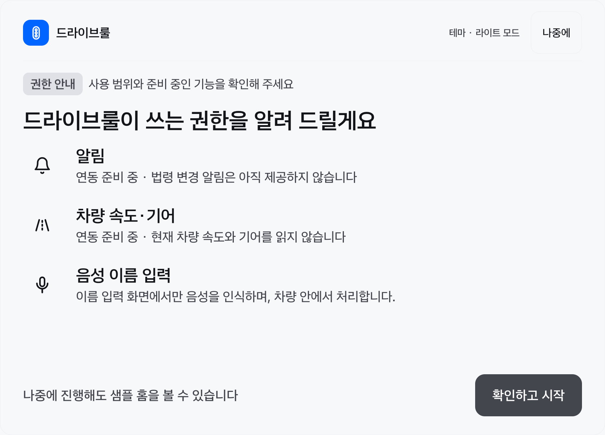
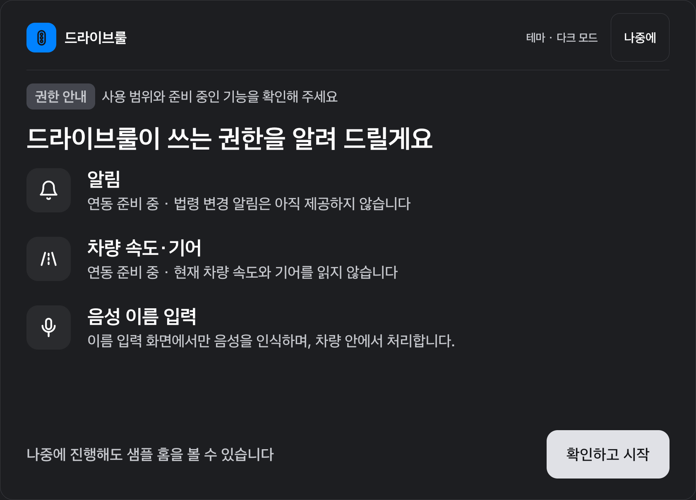

# 최초 권한 안내·음성 이름 입력 검증

2026-11-12. 이 기록은 이전 [UI 구현 검증](ui-implementation-2026-11-12.md)의 ‘권한 안내 없음·음성 입력 준비 중’ 상태를 대체한다.

## 구현 범위

- 최초 등록 또는 이름 건너뛰기 → 권한 안내 → 샘플 홈. ‘나중에’와 ‘확인하고 시작’은 모두 안내 완료를 저장한다.
- 안내를 마치기 전에 종료하면 다음 실행에서 안내를 이어서 표시한다. 두 번째·세 번째 운전자 등록은 이름 저장 후 바로 홈으로 돌아간다.
- Room v2는 최초 안내 상태를 프로필 생성과 같은 트랜잭션으로 기록한다. v1 기존 프로필·현재 선택은 보존하고 안내 완료로 이관한다. 빈 v1 DB는 첫 등록 후 안내를 진행한다.
- 최초·추가 등록의 빈 이름 화면이 RESUMED이고 UX 조작이 허용되면 Pleos SpeechToText 3.3.1을 화면 세션당 한 번 자동 시작한다. 직접 입력한 이름을 자동으로 덮어쓰지 않는다. 최종 인식 결과를 입력란에 반영하고 사용자가 ‘다음’으로 확정한다. 중간 결과는 상태 문구로만 표시한다.
- `Mode.ON_DEVICE`·`Locale.KOREA`를 고정하고 앱의 병합된 `INTERNET` 권한을 제거했다. 앱의 `RECORD_AUDIO` 권한은 선언하지 않으며 Pleos Speech Service가 마이크를 처리한다. 대상 이미지의 `STT_SERVICE`는 normal 권한으로 별도 OS 허용 팝업이 없다.
- 알림·차량 속도/기어·Gleo는 준비 중이다. 원본 Figma의 음성 질문 보관·개인정보 가림·설정 토글 문구를 구현 완료로 표시하지 않는다.

## 음성 수명과 준비 시간

직접 입력, 취소, 이름 화면 이탈, `ON_PAUSE`/`ON_STOP`, UX 제한 시 세션을 취소하고 `stop → removeListener → release`를 시도한다. 늦은 콜백은 세션 ID로 무효화하고 화면이 `RESUMED`일 때만 결과를 반영한다. 같은 화면 세션에서 복귀해도 자동으로 다시 시작하지 않는다. 중지·타임아웃 뒤에는 ‘다시 말하기’로 명시적으로 재시도할 수 있고, 미지원·무음·권한/엔진 오류 후에는 직접 입력을 계속 사용할 수 있다.

Pleos 에뮬레이터가 시스템 재시작한 직후 `request()`부터 로컬 엔진의 recorder 시작까지 약 26초가 걸리는 것을 CAAS 로그로 확인했다. 따라서 준비 중에는 최대 45초, 첫 ready 이후에는 최대 20초를 별도로 적용한다. 중복 ready는 청취 시간을 연장하지 않는다. 준비 중에도 취소가 가능하며 처음에는 시간이 걸릴 수 있다는 문구를 표시한다. 45초는 공식 SDK 보장 시간이 아닌 현재 앱의 상한이다.

## 검증 환경과 경과

Pleos Connect v2.1.0 / Android API34 / x86_64 / RAM4GB, CAAS4.2.10(4002010), 에뮬레이터 `emulator-5554`, 현재 사용자10. 앱 slot은 1682×1210px이고 작은 창 검사는 Compose 내부 540dp·글자 배율1.3이다. 실제 차량의 물리 글자 크기나 실제 1/2-window 전환을 확인한 결과는 아니다.

첫 전체 계측 실행에서 UI 14개와 Room·migration 11개가 통과했다. 음성 UI 테스트 한 건은 고정 하단 버튼에 스크롤 명령을 적용한 테스트 오류여서 해당 명령만 제거했다. 마지막 실제 SDK 검사는 시스템 재시작으로 중단됐다. 재시작의 근본 원인을 STT로 확정하지 않는다.

단독 재검사에서는 SDK initialize/listener/locale/request가 성공했지만 로컬 엔진의 첫 준비가 15초 검사 상한을 넘겼다. 준비 시간이 분리되기 전의 검사 한도 문제이며, 로딩 완료 후 음성 UI 및 실제 서비스 검사를 함께 재실행해 `OK (2 tests)`를 확인했다. 기기 검사는 이름 텍스트를 주입한 UI 검사와 실제 Pleos 서비스 연결 검사를 구분한다.

실제 SDK 검사는 `INTERNET`/`RECORD_AUDIO` 미부여와 `STT_SERVICE` 부여를 확인한 뒤, ON_DEVICE 요청의 ready 콜백을 받고 즉시 종료한다. 사람이 말한 한국어 이름을 최종 텍스트로 인식하는 정확도·잡음·마이크 품질은 이 검사로 입증하지 않는다.

### 최종 결과 — 자동 시작 반영

| 확인 | 결과 |
|---|---|
| lintDebug / testDebugUnitTest / assembleDebug / assembleDebugAndroidTest / compileReleaseKotlin | 성공 |
| JVM | 45개 통과, 실패·오류·건너뛰기 0 |
| lint | 오류 0, 기존 의존성 버전 권고 45건 |
| 기기 검사 | 최초 전체 실행과 수정 후 재실행을 합쳐 29개 서로 다른 시나리오 통과 확인 |
| 자동 시작 변경 후 재검사 | UI 6개 + SDK 1개, `OK (7 tests)` |
| 실제 자동 STT | 이름 화면 진입만으로 실제 SDK ready → ‘듣고 있어요’ 표시 확인. 음성 버튼으로 시작하지 않음 |
| 기존 MainActivity | 최종 APK 설치 후 `운전자 1`과 라이트 모드 유지, 홈 화면 표시 확인 |

자동 시작은 최초·추가 빈 이름 화면 방문당 한 번이다. 이미 입력된 draft는 자동 시작을 막고, 같은 화면에서 일시정지·UX 제한 후 돌아왔을 때 자동 재개하지 않는다. 저장은 사용자가 ‘다음’으로 확정한다. 재검사는 이 흐름과 늦은 결과 무시, 안내·홈 전환, 주야간·작은 창을 포함한다.

일반 병렬 빌드는 개발 PC의 메모리 예약 실패로 중단됐다. 프로젝트 설정을 변경하지 않고 검증 실행에만 `--max-workers=1`, Gradle 1GB·SerialGC, Kotlin in-process, 테스트 JVM 256MB·SerialGC를 적용해 완료했다. JVM 진단 로그는 저장소 밖 로컬 작업 폴더에 보관했다.

이 캡처는 실제 SDK 준비 콜백의 UI 반영을 보여준다. 사람이 말한 이름의 최종 인식 결과나 인식 정확도를 증명하는 캡처는 아니다.

## 화면 확인

실제 Compose 렌더를 캡처해 제목·행 간격·SVG·버튼 접근·라이트/다크를 확인했다. 캡처의 이름은 테스트 fixture이며 실제 음성 인식 성공 증거가 아니다. 기존 사용자의 프로필과 테마를 삭제하거나 새 최초 등록 상태로 바꾸지 않았다.

| 라이트 | 다크 |
|---|---|
|  |  |

- [작은 창·큰 글자 권한 안내](assets/onboarding-permissions/permission-guide-compact-large-font.png)
- [음성 최종 결과 확인 UI](assets/onboarding-permissions/voice-name-confirmation.png)

## 직접 확인 순서

기존 프로필이 있으면 홈 → 운전자 변경 → 운전자 추가로 빈 이름 화면에 진입한다. 음성 입력은 자동으로 준비되며 ‘듣고 있어요’ 표시 후 이름만 말한다. 입력 결과를 확인·수정한 뒤 ‘다음’을 누른다. 중지·타임아웃 후 다시 인식하려면 ‘다시 말하기’를 누른다. 화면을 벗어났다가 같은 세션으로 복귀했을 때도 자동 재개하지 않으므로 필요하면 명시적으로 재시도한다. 이름 입력과 녹음 원본은 서버로 전송하는 앱 경로가 없다.

PC 마이크 입력은 [공식 에뮬레이터 마이크 설정](https://document.pleos.ai/docs/connect/guide/getting-started/application-development/configure-pleos-connect-emulator)의 Extended Controls → Microphone 설정에 따른다. 실제 음성 인식 미확인은 이 수동 확인으로 보완한다. 권한 안내를 다시 보기 위해 기존 앱 데이터를 초기화하지 않는다.

## 공식 근거

- [STT 모드·온디바이스](https://document.pleos.ai/docs/pleos-only/connect-sdk-pleos/SpeechToText/intro)
- [SDK 가져오기](https://document.pleos.ai/docs/pleos-only/connect-sdk-pleos/SpeechToText/importing-sdk)
- [권한 선언](https://document.pleos.ai/docs/pleos-only/connect-sdk-pleos/SpeechToText/declaring-permissions)
- [초기화·해제](https://document.pleos.ai/docs/pleos-only/connect-sdk-pleos/SpeechToText/initialization-and-release)
- [결과 리스너](https://document.pleos.ai/docs/pleos-only/connect-sdk-pleos/SpeechToText/result-listeners)
- [시작·정지](https://document.pleos.ai/docs/pleos-only/connect-sdk-pleos/SpeechToText/start-and-stop)
- [Figma 출처와 의도적 차이](figma-assets.md#01-3-권한-안내-화면)
